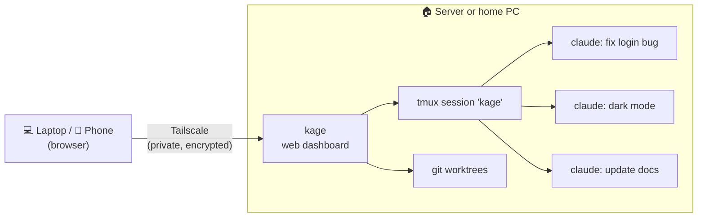

<p align="center">
  
</p>

<h1 align="center">kage</h1>

<p align="center">
  <b>Your Claude Code agents, working in the shadows.</b><br>
  Run Claude Code sessions on your server or home PC. Start, watch, answer and stop them from your laptop or phone.
</p>

<p align="center">
  <a href="LICENSE"></a>
  
  
</p>

---

*Kage* (影) is Japanese for "shadow".

You leave your desk, but your agents keep working. Kage is a small web dashboard that runs on your server or home PC and gives you every Claude Code session in one place. It works from the couch, the office or a train. When an agent needs an answer, Kage pings your phone. When it starts a dev server, Kage gives you the preview link.

It is a thin layer over tools you already trust: **tmux** keeps the sessions alive, **git** tracks what changed, and **Tailscale** keeps everything private. Kage adds no database, no build step and no open router ports.

## Features

- **Every session at a glance.** Each Claude Code session is a tmux window with a status: 🟢 running, 🟡 waiting for you, ⚪ done.
- **Live output.** Follow the last lines of any session as it works.
- **Start tasks from anywhere.** Type a task and Kage opens a new tmux window in its own git worktree and starts `claude` on it.
- **Answer from your phone.** When an agent asks a question, reply in the browser and Kage sends your answer to the session.
- **Preview links.** Kage finds the ports your agents are serving and links you straight to `http://your-pc:PORT`.
- **Files changed.** See what each agent touched, with a diff view.
- **Notifications.** Get a ping through [ntfy](https://ntfy.sh) or a browser notification when a session needs input.
- **Attach any time.** Kage only adds to your setup: `tmux attach -t kage` still drops you into the real terminal.
- **Phone-friendly.** It works in a phone browser too.

## How it works

<p align="center">
  
</p>



Kage listens on your Tailscale address only, so the dashboard can't be reached from the public internet or your local Wi-Fi.

## Requirements

- A server or home PC that stays on (Linux or macOS; on Windows, use WSL)
- [Node.js](https://nodejs.org) 24.2 or newer
- [tmux](https://github.com/tmux/tmux)
- [git](https://git-scm.com)
- [Claude Code](https://docs.claude.com/en/docs/claude-code), signed in on the PC
- [Tailscale](https://tailscale.com) on the PC and on every device you connect from

## Quick start

Kage is in early development, and the installer comes in a later phase. For now, run it from a checkout in demo mode, with sample sessions and no tmux needed:

```sh
git clone https://github.com/eridian-io/kage.git
cd kage
corepack enable
pnpm install
pnpm dev
```

Then open the address it prints. You need Node 24.2 or newer, and Tailscale up (or run `KAGE_HOST=127.0.0.1 pnpm dev` to stay on loopback). To serve a built checkout instead, run `pnpm build` and then `node packages/server/src/main.ts serve --demo`.

## Try it with real sessions

Live sessions need Linux or macOS with tmux 3.2 or newer. On Windows, use WSL and clone the repo inside WSL's own file system (for example `~/kage`), not under `/mnt/c`. There is no installer yet: it comes in phase 6, so for now run the command from the checkout. A shell function makes the steps below shorter:

```sh
kage() { node "$HOME/kage/packages/server/src/main.ts" "$@"; }
```

Adjust the path to where you cloned the repo.

1. Install and build the board, once: `corepack enable && pnpm install && pnpm build`.
2. Start Kage on loopback: `KAGE_HOST=127.0.0.1 kage serve`. Without `KAGE_HOST` it listens on your Tailscale address. Open the address it prints, for example `http://127.0.0.1:8080`, in any browser that can reach it.
3. `kage serve` creates the tmux session `kage`. Its first window only holds the session open, so the board hides it while it sits at a shell. From a second terminal, start Claude in a new window of that session, in your project's folder:

```sh
tmux new-window -t kage -c ~/projects/my-app "exec claude --settings '$(kage hooks-path)' --permission-mode default"
```

Or attach (`tmux attach -t kage`), open a new window (`Ctrl-b c`) and run `claude --settings "$(kage hooks-path)" --permission-mode default` there. Either way, `kage` must be defined in the shell you type it in: the shell function above, in your shell's startup file.

`kage hooks-path` writes the settings that send Claude's hook events to Kage, and prints the file's path (`$XDG_STATE_HOME/kage/claude-settings.json`, or `~/.local/state/kage/claude-settings.json`). Pass `--permission-mode default` too: Claude Code 2.1.330 starts in auto mode, which never asks, so Kage would never see a prompt.

The session appears on the board with live status and output. It turns amber when Claude asks for permission or asks a question, and done when Claude finishes or waits for your next prompt. The first run in a new folder shows Claude's folder-trust screen, and Kage reads it from the pane and shows it as "needs you" too. Answer it from the board, or in the terminal.

`kage serve --demo` still runs the sample sessions with no tmux.

Hook events travel over a Unix socket, `$XDG_RUNTIME_DIR/kage.sock` by default; `kage serve` sets `KAGE_SOCKET` in the tmux session, so Claude in its windows finds the same socket. To move it, set `KAGE_SOCKET`; the directory it sits in must be owned by you, and Kage refuses a shared one such as `/tmp`. Set `KAGE_TMUX_SOCKET` to use a separate tmux server (`tmux -L <name>`).

## Control

Kage can start and steer tasks from the board. This needs `claude` on Kage's `PATH` (or `KAGE_CLAUDE_BIN` set to it) and a git project directly inside `projectsRoot`.

**Start a task.** Press `N` or click New task. Type the task, pick the project and the branch to start from, and press Start (or Enter). Kage makes a git worktree at `<project>/.worktrees/<name>` on a new branch `kage/<name>`, opens a tmux window there and runs `claude` on your task. Start waits until the window is up, then selects the new session. Tick "Accept edits automatically" to let Claude edit files without asking. Commands still ask.

**Answer.** When Claude asks for permission or asks a question, the card shows its options as buttons. Click one, or press its number (`1`–`9`). Kage checks that the same question is still on the screen before it sends the key. A few options stay disabled and say "Choose this one in the terminal": switching to auto mode, and questions that take several choices.

**Reply and follow-up.** Type in the box under the card and press Enter to answer a prompt in your own words. On a finished session the same box sends a follow-up task, and the session runs again. `R` jumps to the box. A reply can't start with `!`, `#`, `/` or a number: use the terminal for those.

**Stop.** Click Stop, or press `X` twice within two seconds. Kage closes that session's tmux window. The worktree and the branch stay. Kage only stops windows it started.

**Ports and files.** A port that a task opens appears on the right with a link. A port that listens only on the PC says "Only on this machine" and shows the `ssh -L` command to reach it. The files the task changed, including uncommitted ones, are listed with their line counts.

**Token login.** Set `token` in the config (at least 16 characters) and restart. The board then asks for it once and keeps you signed in for 30 days. To sign out every device, change the token and restart Kage. Five wrong tries from one address lock that address out for a minute.

## Configuration

Kage reads `~/.config/kage/config.json`, or `$XDG_CONFIG_HOME/kage/config.json` when `XDG_CONFIG_HOME` is set. The file is optional: every key has a default, and unknown keys are ignored. It lives outside the checkout, so hostnames and secrets never end up in the repo.

```json
{
  "name": "my-pc",
  "host": null,
  "port": 8080,
  "projectsRoot": "~/projects",
  "tmuxSession": "kage",
  "worktreeDir": ".worktrees",
  "branchPrefix": "kage/",
  "autoArchive": { "onMerge": true, "afterDays": 14 },
  "ntfyTopic": "",
  "token": ""
}
```

| Key | Default | Meaning |
|---|---|---|
| `name` | The PC's hostname, before the first dot | The name in the dashboard's host pill and in the address Kage prints |
| `host` | `null` | The address to listen on. `null` uses your Tailscale IP (from `tailscale ip -4`). Kage only accepts a Tailscale or loopback address, or a name that resolves to one |
| `port` | `8080` | The port the dashboard listens on |
| `projectsRoot` | `"~/projects"` | The folder that holds your git projects |
| `tmuxSession` | `"kage"` | The tmux session Kage uses for agent windows |
| `worktreeDir` | `".worktrees"` | The folder, inside each project, for the agents' git worktrees |
| `branchPrefix` | `"kage/"` | The prefix for the branches Kage creates |
| `autoArchive` | `{ "onMerge": true, "afterDays": 14 }` | Archive a done session when its branch is merged, or after this many days |
| `ntfyTopic` | `""` | Optional: your [ntfy](https://ntfy.sh) topic for phone notifications |
| `token` | `""` | Optional access token, at least 16 characters. When set, the dashboard asks for it once and keeps you signed in with an `HttpOnly` cookie for 30 days; `""` means no sign-in. Change the token to sign out every device. |

Live sessions use `tmuxSession`, `token`, `projectsRoot`, `worktreeDir`, `branchPrefix` and the host, port and name keys. `autoArchive` and `ntfyTopic` take effect in later phases; Kage already reads and checks every key.

The environment variables `KAGE_NAME`, `KAGE_HOST` and `KAGE_PORT` override `name`, `host` and `port`. `KAGE_CLAUDE_BIN` names the `claude` program for new tasks.

`pnpm dev` needs Tailscale to be up. Without it, run it on loopback instead: `KAGE_HOST=127.0.0.1 pnpm dev`.

## Run on boot

To keep Kage running across reboots, install it as a systemd user service:

```sh
npm run install-service
```

## Safety

- Kage binds to your Tailscale IP only, so only devices on your tailnet can reach it.
- It never kills tmux windows it didn't create.
- Each task runs in its own git worktree, so agents don't trip over each other or over your own work.
- Claude Code can run commands on your PC. Only add devices you trust to your tailnet.

## Roadmap

- [x] **Phase 1, skeleton:** dashboard served over Tailscale
- [x] **Phase 2, sessions:** live tmux sessions with status from hooks and output from transcripts
- [x] **Phase 3, control:** start, answer and stop tasks; preview links; token login
- [ ] **Phase 4, polish:** notifications, diffs, run on boot, phone layout

## Contributing

Issues and pull requests are welcome. Before your first pull request is merged, you'll be asked to sign a short Contributor License Agreement.

## License

Kage is licensed under the [GNU Affero General Public License v3.0](LICENSE). You may use, change and share it freely. Any version you distribute or run as a network service must stay open source under the same license.

If you want to use Kage in a closed-source product, a commercial license is available. Open an issue to get in touch.

---

<sub>Kage is an independent project and is not affiliated with or endorsed by Anthropic. Claude and Claude Code are trademarks of Anthropic.</sub>
