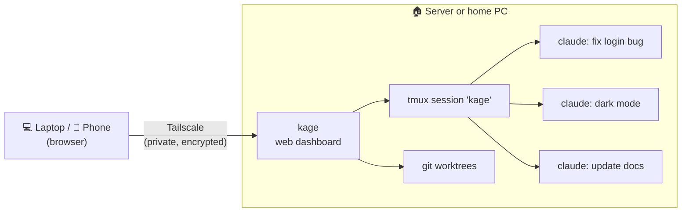

<p align="center">
  
</p>

<h1 align="center">kage</h1>

<p align="center">
  <b>Your Claude Code agents, working in the shadows.</b><br>
  Run Claude Code sessions on your server or home PC. Start, watch, answer and stop them from your laptop or phone.
</p>

<p align="center">
  <a href="https://github.com/eridian-io/kage/blob/main/LICENSE"></a>
  
  
</p>

---

*Kage* (影) is Japanese for "shadow".

You leave your desk, but your agents keep working. Kage is a small web dashboard that runs on your server or home PC and gives you every Claude Code session in one place. It works from the couch, the office or a train. When an agent needs an answer, Kage pings your phone. When it starts a dev server, Kage gives you the preview link.

It is a thin layer over tools you already trust: **tmux** keeps the sessions alive, **git** tracks what changed, and **Tailscale** keeps everything private. Kage adds no database and no open router ports.

## Features

- **Every session at a glance.** Each Claude Code session is a tmux window with a status: 🟢 running, 🟡 waiting for you, ⚪ done.
- **Live output.** Follow the last lines of any session as it works.
- **Start tasks from anywhere.** Type a task and Kage opens a new tmux window in its own git worktree and starts `claude` on it.
- **Answer from your phone.** When an agent asks a question, reply in the browser and Kage sends your answer to the session.
- **Preview links.** Kage finds the ports your agents are serving and links you straight to `http://your-pc:PORT`.
- **Files changed.** See what each agent touched, with a diff view.
- **Finish sessions.** Pin, archive, resume and delete sessions. Delete tells you what you would lose first.
- **A terminal in the browser.** Open the real tmux window of a session when the buttons are not enough.
- **Notifications.** A ping on your phone through [ntfy](https://ntfy.sh) when a session needs you, and the count in the browser's tab title.
- **A command palette.** `⌘K` (`Ctrl+K` off a Mac) jumps to a session or runs a command.
- **Attach any time.** Kage only adds to your setup: `tmux attach -t kage` still drops you into the real terminal.
- **Phone-friendly.** It works in a phone browser too.

## How it works

<p align="center">
  
</p>



Kage listens on your Tailscale address only, so the dashboard can't be reached from the public internet or your local Wi-Fi.

## Requirements

- A server or home PC that stays on (Linux or macOS; on Windows, use WSL)
- [tmux](https://github.com/tmux/tmux) 3.2 or newer
- [git](https://git-scm.com) 2.40 or newer
- [Claude Code](https://docs.claude.com/en/docs/claude-code), signed in on the PC
- [Tailscale](https://tailscale.com) on the PC and on every device you connect from
- [Node.js](https://nodejs.org) 24.2 or newer, only for the npm package or a checkout. A release install brings its own.

`kage setup` checks each of these and says how to install what's missing.

## Install

**The one-line install works once the first release is out.** No release exists yet. Until then, install from a checkout (below).

```sh
curl -fsSL https://raw.githubusercontent.com/eridian-io/kage/main/install.sh | sh
```

`install.sh` is short and plain POSIX shell, so read it before you run it: open the same URL in your browser, or save it first with `curl -fsSL … -o install.sh`. It:

1. refuses to run as root, and never calls `sudo`;
2. picks the build for your machine: Linux or macOS, x64 or arm64 (a shell under Rosetta gets the arm64 build). On Windows it tells you to use WSL;
3. downloads that build and `SHA256SUMS` from the latest release, over HTTPS only, and stops unless the checksum matches;
4. puts the program at `~/.local/bin/kage` in one step, replacing an older one;
5. if that folder isn't on your `PATH`, adds an `export PATH=…` line, marked `# Added by the Kage installer.`, to your shell's start-up file: `~/.zshrc` for zsh; `~/.bashrc` and `~/.bash_profile` (or `~/.profile`) for bash; `~/.profile` otherwise. It says what it changed;
6. runs `kage setup` in your terminal, which asks before it changes anything.

To pass setup's options, put them after `sh -s --`, for example `… | sh -s -- --yes --no-linger`. These variables change what the installer does:

| Variable | Effect |
|---|---|
| `KAGE_INSTALL_DIR` | Install into this folder instead of `~/.local/bin` |
| `KAGE_NO_MODIFY_PATH=1` | Print the `PATH` line instead of writing it |
| `KAGE_NO_SETUP=1` | Install only; run `kage setup` yourself later |

**With npm**, once the first release is out, if you already use Node 24.2 or newer:

```sh
npm install -g @eridian-io/kage
kage setup
```

**From a checkout**, which works today:

```sh
git clone https://github.com/eridian-io/kage.git
cd kage
corepack enable
pnpm install
pnpm build
node packages/server/dist/kage.mjs setup
```

The service then runs this checkout's build with this Node. To use `kage` by name, add a shell function to your shell's start-up file (adjust the path):

```sh
kage() { node "$HOME/kage/packages/server/dist/kage.mjs" "$@"; }
```

On Windows, clone inside WSL's own file system (for example `~/kage`), not under `/mnt/c`.

## Commands

- **`kage setup`** checks what Kage needs, asks for the projects folder, the host name, the port and whether to set an access token, saves them in the config, and installs and starts the service. Then it checks that the board answers and prints its address. Run it again any time to change a setting. `--yes` takes every default and asks nothing; `--projects DIR`, `--host NAME`, `--port N`, `--token` or `--no-token`, `--no-service`, and `--linger` or `--no-linger` answer one question each.
- **`kage status`** shows the version, the service, the board's address and how many sessions need you.
- **`kage doctor`** checks everything again (the tools, Claude's sign-in, Tailscale, the config, the service, the board, your `PATH`) and says what to fix. It changes nothing.
- **`kage update`** installs the latest release, checked against its SHA-256 like the installer does, and restarts the service if it was running. It runs only when you ask: Kage never checks for updates on its own. The old program stays next to the new one as `kage.previous`, and if the new one doesn't answer, update prints the command that goes back. `--force` installs the release even if it isn't newer. An npm or checkout install is updated with npm, or with `git pull` and `pnpm build`.
- **`kage uninstall`** asks, then removes the service, the program and Kage's hooks file. It keeps your projects, their worktrees and branches, the tmux session (`kage`, or the `tmuxSession` you set) with its windows, and Kage's config and state folders; `--purge` removes those two folders too. It never edits your shell's start-up file: it names the lines the installer added, for you to remove. `--yes` skips the question.

## The service

`kage setup` installs Kage as a service, so it starts on boot and comes back if it stops:

- **Linux:** a systemd user unit, `~/.config/systemd/user/kage.service` (or under the `XDG_CONFIG_HOME` of systemd's user manager, if it has one; one set only in your shell doesn't count). Logs: `journalctl --user -u kage`.
- **macOS:** a launchd agent, `~/Library/LaunchAgents/io.eridian.kage.plist`. Logs: `~/Library/Logs/kage.log`. (Documented, not observed: see "On macOS".)

The unit holds no secrets: just the program and what it adds to the user manager's environment, a `PATH` and two settings, plus these when they are set where you run setup: `KAGE_CLAUDE_BIN`, `CLAUDE_CONFIG_DIR`, `XDG_CONFIG_HOME`, `XDG_STATE_HOME` and `KAGE_TMUX_SOCKET`. The token stays in the config. An `ANTHROPIC_API_KEY` set in your shell never goes into the unit, so Claude in Kage's windows needs its own sign-in (run `claude` once); `kage doctor` reminds you.

**Linger.** A user unit normally stops when you log out, and starts only when you log in. With linger on, systemd starts it at boot and keeps it running. Setup asks to turn it on (`--yes` turns it on; `--no-linger` leaves it off) and says so when it does. To turn it off again: `loginctl disable-linger`. `kage uninstall` leaves linger as it is and reminds you if it is on.

**Waiting for Tailscale.** Kage listens on your Tailscale address. Until Tailscale has one, Kage stops and the service starts it again every 5 seconds; `kage status` says "starting (waiting for Tailscale?)" meanwhile.

**Your sessions outlive the service.** Under systemd, Kage starts tmux in a scope of its own (`systemd-run --user --scope`), so restarting, updating or uninstalling Kage leaves tmux and every Claude session running. If that doesn't work on your machine, Kage logs one line, "couldn't start tmux in a scope of its own", and starts tmux inside the service. Then a restart, `kage update` or `kage uninstall` ends the tmux session and every Claude in it. On macOS the agent is set so launchd leaves tmux running when Kage stops (documented, not observed).

**After a reboot**, sessions show as "ended", and you resume the ones you want with `U`.

**The `PATH` the service sees** is the one setup ran with, and so are the settings above. If you move `claude`, `tmux` or `git` later, or change one of those settings, run `kage setup` again; `kage doctor` tells you when the service can't find a program.

### On WSL

- The service needs systemd. Add this to `/etc/wsl.conf`, then run `wsl --shutdown` in Windows and open WSL again:
  ```
  [boot]
  systemd=true
  ```
  Without it, setup says so and skips the service; run `kage serve` yourself instead.
- WSL starts only when you open it, not when Windows boots, so neither does Kage, linger or not.
- A user unit doesn't read `~/.bashrc`, where tools such as `claude` are often put on the `PATH`. Run `kage setup` from a shell where `claude` works, so it captures that `PATH`.

### On macOS

These notes follow Apple's and Node's documentation. Kage hasn't been run on a Mac yet.

- The agent starts when you log in, not at boot. For Kage to run after a reboot with nobody at the Mac, turn on automatic login.
- If `tailscale` isn't on your `PATH`, Kage uses the Tailscale app's own command line.
- Kage can't tell whether Claude Code is signed in on macOS, so doctor asks you to run `claude` once to check.
- The program is ad-hoc signed. `curl` doesn't mark downloads as quarantined, so the installer's copy runs. A copy downloaded in a browser needs `xattr -d com.apple.quarantine kage` first.

## Start Claude sessions

Start a task from the board with `N` (see Control), or start Claude yourself in the tmux session `kage` with Kage watching. In your project's folder:

```sh
tmux new-window -t kage -c ~/projects/my-app "exec claude --settings '$(kage hooks-path)' --permission-mode default"
```

Or attach (`tmux attach -t kage`), open a new window (`Ctrl-b c`) and run `claude --settings "$(kage hooks-path)" --permission-mode default` there.

`kage hooks-path` writes the settings that send Claude's hook events to Kage, and prints the file's path (`$XDG_STATE_HOME/kage/claude-settings.json`, or `~/.local/state/kage/claude-settings.json`). Kage never changes Claude's own settings. Pass `--permission-mode default` too: Claude Code 2.1.330 starts in auto mode, which never asks, so Kage would never see a prompt.

The session appears on the board with live status and output. It turns amber when Claude asks for permission or asks a question, and done when Claude finishes or waits for your next prompt. The first run in a new folder shows Claude's folder-trust screen, and Kage reads it from the pane and shows it as "needs you" too. Answer it from the board, or in the terminal.

The tmux session's first window only holds the session open, so the board hides it while it sits at a shell.

To run Kage without the service, start it yourself with `kage serve` (add `KAGE_HOST=127.0.0.1` to stay on loopback) and open the address it prints. Live mode needs an access token (`kage setup` sets one); without one it refuses to start unless you pass `--allow-no-token` or set `allowNoToken`.

Hook events travel over a Unix socket, `$XDG_RUNTIME_DIR/kage.sock` by default; `kage serve` sets `KAGE_SOCKET` in the tmux session, so Claude in its windows finds the same socket. To move it, set `KAGE_SOCKET`; the directory it sits in must be owned by you, and Kage refuses a shared one such as `/tmp`. Set `KAGE_TMUX_SOCKET` to use a separate tmux server (`tmux -L <name>`).

## Try the demo

To look around first, run the board with sample sessions and no tmux, from a checkout:

```sh
git clone https://github.com/eridian-io/kage.git
cd kage
corepack enable
pnpm install
pnpm dev
```

Then open the address it prints. You need Node 24.2 or newer, and Tailscale up (or run `KAGE_HOST=127.0.0.1 pnpm dev` to stay on loopback). An installed Kage shows the same with `kage serve --demo`.

## Control

Kage can start and steer tasks from the board. This needs `claude` on Kage's `PATH` (or `KAGE_CLAUDE_BIN` set to it) and a git project directly inside `projectsRoot`.

**Start a task.** Press `N` or click New task. Type the task, pick the project and the branch to start from, and press Start (or Enter). Kage makes a git worktree at `<project>/.worktrees/<name>` on a new branch `kage/<name>`, opens a tmux window there and runs `claude` on your task. Start waits until the window is up, then selects the new session. Tick "Accept edits automatically" to let Claude edit files without asking. Commands still ask.

**Answer.** When Claude asks for permission or asks a question, the card shows its options as buttons. Click one, or press its number (`1`–`9`). Kage checks that the same question is still on the screen before it sends the key. A few options stay disabled and say "Choose this one in the terminal": switching to auto mode, and questions that take several choices.

**Reply and follow-up.** Type in the box under the card and press Enter to answer a prompt in your own words. On a finished session the same box sends a follow-up task, and the session runs again. `R` jumps to the box. A reply can't start with `!`, `#`, `/` or a number: use the terminal for those.

**Stop.** Click Stop, or press `X` twice within two seconds. Kage closes that session's tmux window. The worktree and the branch stay. Kage only stops windows it started.

**Ports and files.** A port that a task opens appears on the right with a link. A port that listens only on the PC says "Only on this machine" and shows the `ssh -L` command to reach it. The files the task changed, including uncommitted ones, are listed with their line counts.

**Token login.** Set `token` in the config (at least 16 characters) and restart. The board then asks for it once and keeps you signed in for 30 days. To sign out every device, change the token and restart Kage. Five wrong tries from one address lock that address out for a minute.

## Finish and terminal

**Pin.** Press `S`, or click the ★ in the session's header. A pinned session sorts first among the done ones and is never archived automatically.

**Archive.** Press `E` on a done or ended session. Kage closes its `claude` window and hides it, and keeps the worktree and the branch. Archived sessions are listed under "archived N" at the bottom of the left column, and Restore brings one back. A running session can't be archived: stop it first.

**Auto-archive.** With `autoArchive.onMerge`, a done session is archived once its branch is merged into the base branch. With `autoArchive.afterDays`, it is archived that many days after it finished (`0` turns the age rule off). Pinned sessions are exempt, and so is a session with a terminal open. Restoring or unpinning a session starts its clock again.

**Resume.** When `claude` has exited (after a reboot, say), the session shows "ended". Press `U` and Kage opens a new window in the same worktree and runs `claude --resume` on the old conversation. Kage never resumes sessions by itself.

**Delete.** Click Delete…. The confirmation lists what would be lost: commits only this branch has, files with uncommitted changes, and ignored files such as `.env`. Press Delete session to confirm. A click within a moment of the counts changing is ignored, since it was meant for the old counts. Kage then removes the worktree and the branch. If the counts changed since you looked, nothing is removed and the new counts show. Kage deletes only worktrees and branches it made (a branch with the configured `branchPrefix`; with `branchPrefix` set to `""` that check is off), and it never runs `git worktree prune`.

**View diff.** "View diff →" in the right column opens a read-only diff of the same files as the list: everything since the branch left its base, uncommitted and untracked files included. Long diffs come a page at a time (Previous and Next). `J` and `K` jump between the files on a page, and `Esc` goes back.

**Terminal.** Press `T`. The session's tmux window opens in the browser, and every key goes to Claude, including `Esc`. Press `Shift+Esc` (or `Ctrl+Shift+X`) to return to the board. Chrome's Task Manager may take `Shift+Esc` on Windows and Linux: use `Ctrl+Shift+X` there. A window Kage didn't start is view-only. The terminal code (about 90 KB) loads the first time you open one.

## Notifications

Kage tells you when a session needs you, in two ways.

**On your phone, through [ntfy](https://ntfy.sh).** It is off until you set a topic.

1. Install the ntfy app on your phone and subscribe to a topic name.
2. Put the same name in the config as `ntfyTopic`, and restart Kage.
3. Run `kage ping`. Your phone should show "Kage test ping". If it can't send, the command says why (for example `HTTP 401` or `ECONNREFUSED`) and exits with 1.

A topic on ntfy.sh is public: anyone who guesses the name can read your pings, and send their own. So pick a long random one. Kage refuses to start with a topic shorter than 16 characters on ntfy.sh unless you also set `ntfyToken`. For example, run `openssl rand -hex 12` and use the result.

| Key | Default | Meaning |
|---|---|---|
| `ntfyTopic` | `""` | The topic to publish to. Empty means no pings. 1 to 64 letters, digits, `-` or `_` |
| `ntfyServer` | `"https://ntfy.sh"` | The ntfy server. It must be `https:`. Plain `http:` is allowed only for this machine (`localhost`, `127.x.x.x` or `[::1]`) or your tailnet (an address in `100.64.0.0/10` or `fd7a:115c:a1e0::/48`, or a `*.ts.net` name). Use plain `http:` to a `*.ts.net` name only for a machine on your own tailnet: Tailscale Funnel names also end in `.ts.net` and resolve publicly, and Kage can't tell them apart |
| `ntfyToken` | `""` | An ntfy access token, for a server that needs one. 1 to 128 letters, digits, `-` or `_`. Kage sends it as a bearer token |
| `ntfyOnDone` | `false` | Also ping when a session that worked for a minute or more is done |

When you get a ping:
- A session that moves into "needs you" is pinged after 3 seconds, if it is still waiting. Answer it at the board within that time and nothing is sent.
- A session is pinged at most once every 2 minutes, and a question asked again inside that time is pinged when the 2 minutes are over.
- With `ntfyOnDone`, a session that worked for at least a minute and then finished is pinged "is done". A session you stopped is not, nor one whose prompt you answered No or Esc.
- At most 10 pings go out in any 10 minutes. Kage logs how many it skipped.
- Sessions already waiting when Kage starts are not pinged.
- A failed ping is tried again after 2, 8 and 30 seconds, then given up. Tapping a ping opens that session on the board.

**What the ntfy server sees.** The topic, a title such as "my-app needs you", the task text (cut to 100 characters), the board link (your machine's name, the port and the session's id), and your PC's address and the time. It never gets the question, the output, a command, a branch or a path. A window Kage didn't start has no task to show: its ping says "Claude needs you" with the PC's name. Kage logs no topic, token or server address; a failure is named by a status or an error code only. If the task text itself is private, use your own ntfy server, or leave ntfy off.

**In the browser.** The tab's title shows how many sessions need you, as "(2) kage". Browser notifications need `https:` or `localhost`: a browser doesn't offer them on a plain `http://my-pc.tail1234.ts.net:8080` over the tailnet. Over plain tailnet `http:`, you get the tab title and ntfy. On `localhost`, open the command palette and choose "Turn on browser notifications". A notification shows only when a session starts to need you while the page has no focus, with the same text as a ping.

## Command palette

Press `⌘K` on a Mac, or `Ctrl+K` elsewhere (or click the hint at the top right). Type to jump to a session, or to run a command on the selected session: View diff, Open the terminal, Pin, Archive, Resume, Stop, Delete…. It also starts a New task, shows archived sessions and turns on browser notifications. Arrow keys move, `Enter` runs, and `Esc` closes. The palette loads the first time you open it.

## Configuration

Kage reads `~/.config/kage/config.json`, or `$XDG_CONFIG_HOME/kage/config.json` when `XDG_CONFIG_HOME` is set. The file is optional: every key has a default, and unknown keys are ignored. `kage setup` writes the keys it asks about, readable by you only, and keeps the rest. It lives outside the checkout, so hostnames and secrets never end up in the repo.

```json
{
  "name": "my-pc",
  "host": null,
  "port": 8080,
  "projectsRoot": "~/projects",
  "tmuxSession": "kage",
  "worktreeDir": ".worktrees",
  "branchPrefix": "kage/",
  "autoArchive": { "onMerge": true, "afterDays": 14 },
  "ntfyTopic": "",
  "ntfyServer": "https://ntfy.sh",
  "ntfyToken": "",
  "ntfyOnDone": false,
  "token": "",
  "allowNoToken": false
}
```

| Key | Default | Meaning |
|---|---|---|
| `name` | The PC's hostname, before the first dot | The name in the dashboard's host pill. It is only a label: Kage doesn't answer to it |
| `host` | `null` | The address to listen on. `null` uses your Tailscale IP (from `tailscale ip -4`). Kage only accepts a Tailscale or loopback address, or a name that resolves to one. Kage answers to its Tailscale IP and full MagicDNS name (`box.tail1234.ts.net`), and to the name you set here. To use the short name (`box`), set it by hand in the config file; `kage setup` won't write it. A `.local` name or a single word here means trusting everyone on your local network |
| `port` | `8080` | The port the dashboard listens on |
| `projectsRoot` | `"~/projects"` | The folder that holds your git projects |
| `tmuxSession` | `"kage"` | The tmux session Kage uses for agent windows |
| `worktreeDir` | `".worktrees"` | The folder, inside each project, for the agents' git worktrees |
| `branchPrefix` | `"kage/"` | The prefix for the branches Kage creates |
| `autoArchive` | `{ "onMerge": true, "afterDays": 14 }` | Archive a done session when its branch is merged, or this many days after it finished (`0` turns the age rule off) |
| `ntfyTopic` | `""` | Optional: your [ntfy](https://ntfy.sh) topic for phone pings. On ntfy.sh it must be a long random name (see Notifications) |
| `ntfyServer` | `"https://ntfy.sh"` | The ntfy server (see Notifications) |
| `ntfyToken` | `""` | Optional ntfy access token |
| `ntfyOnDone` | `false` | Also ping when a long-running session is done |
| `token` | `""` | Optional access token, at least 16 characters. When set, the dashboard asks for it once and keeps you signed in with an `HttpOnly` cookie for 30 days; `""` means no sign-in, and then live mode starts only with `allowNoToken`. Change the token to sign out every device. |
| `allowNoToken` | `false` | `true` lets live mode run without a token, so anyone who can reach Kage can run commands as you. Without it (or `kage serve --allow-no-token`) Kage refuses to start with no token. `kage setup` sets it when you answer no to the token |

Live sessions use every key. Kage checks them all when it starts and stops with one line if a value is wrong. The pings need live mode: the demo sends none.

The environment variables `KAGE_NAME`, `KAGE_HOST` and `KAGE_PORT` override `name`, `host` and `port`. `KAGE_CLAUDE_BIN` names the `claude` program for new tasks.

`pnpm dev` needs Tailscale to be up. Without it, run it on loopback instead: `KAGE_HOST=127.0.0.1 pnpm dev`.

## Safety

- Kage binds to your Tailscale IP only, so only devices on your tailnet can reach it.
- It never kills tmux windows it didn't create.
- Each task runs in its own git worktree, so agents don't trip over each other or over your own work.
- Claude Code can run commands on your PC. Only add devices you trust to your tailnet.
- Nothing installs or runs as root. A step that needs root is printed for you to run.
- The running Kage contacts nothing outside your machine except your ntfy server, and only when you set a topic. `kage update` and the installer download from GitHub, only when you run them, over HTTPS, and check the program against the release's `SHA256SUMS`. `kage update` also runs the new program and checks that it reports the release's version. `kage ping` sends one test ping to your ntfy server.
- The checksum catches a broken download, not a forged release. To check that a release was built from this repository, verify it with the GitHub CLI: `gh attestation verify kage-linux-x64.gz --repo eridian-io/kage`.

## Releasing

For maintainers, and only on the owner's go:

1. Set the new version in `packages/server/package.json`.
2. Tag the commit `v<version>` and push the tag.

The release workflow does the rest: it builds and smoke-tests the program for each platform, makes the npm package, `VERSION` and `SHA256SUMS`, attests them, creates the GitHub release and publishes to npm. A version with a `-` (`1.2.0-rc.1`) is a pre-release, which `kage update` and the installer don't pick up. `pnpm release:local` builds the same files for this machine into `dist/release`.

The one-line install fetches `install.sh` from `main`, so the branch that holds it must be merged into `main` before the first tag.

## Roadmap

- [x] **Phase 1, skeleton:** dashboard served over Tailscale
- [x] **Phase 2, sessions:** live tmux sessions with status from hooks and output from transcripts
- [x] **Phase 3, control:** start, answer and stop tasks; preview links; token login
- [x] **Phase 4, finish and terminal:** pin, archive, auto-archive, delete with a warning, resume, a diff view and a terminal in the browser
- [x] **Phase 5, polish:** notifications through ntfy and the browser, a command palette, performance budgets
- [ ] **Phase 6, install and release:** `kage setup`, services that start on boot, single-file releases (built; waiting for the first release)

## Contributing

Issues and pull requests are welcome. Before your first pull request is merged, you'll be asked to sign a short Contributor License Agreement.

## License

Kage is licensed under the [GNU Affero General Public License v3.0](https://github.com/eridian-io/kage/blob/main/LICENSE). You may use, change and share it freely. Any version you distribute or run as a network service must stay open source under the same license.

If you want to use Kage in a closed-source product, a commercial license is available. Open an issue to get in touch.

---

<sub>Kage is an independent project and is not affiliated with or endorsed by Anthropic. Claude and Claude Code are trademarks of Anthropic.</sub>
