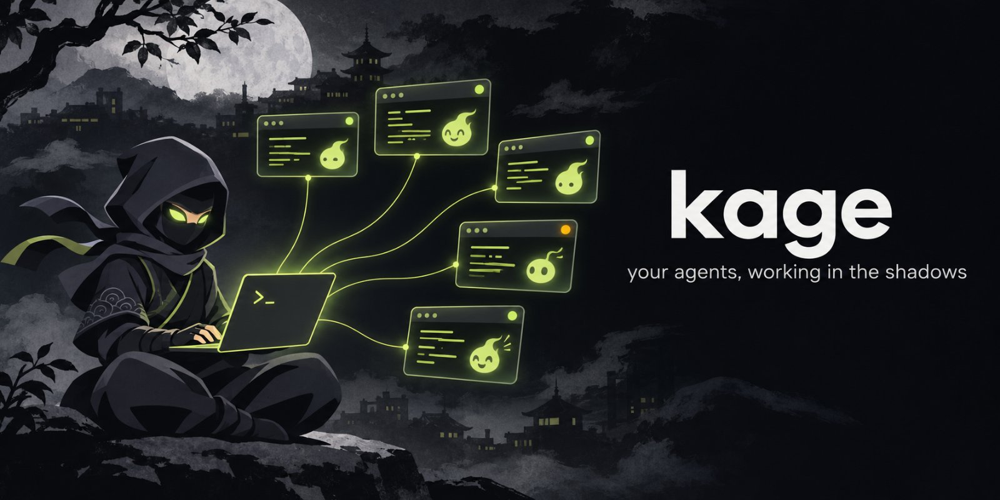
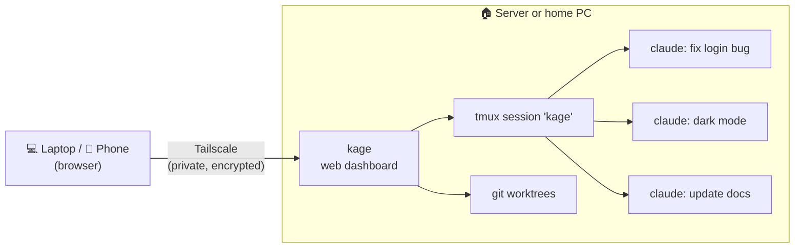

<p align="center">
  
</p>

<h1 align="center">kage</h1>

<p align="center">
  <b>Your Claude Code agents, working in the shadows.</b><br>
  Run Claude Code sessions on your server or home PC. Start, watch, answer and stop them from your laptop or phone.
</p>

<p align="center">
  <a href="LICENSE"></a>
  
  
</p>

---

*Kage* (影) is Japanese for "shadow".

You leave your desk, but your agents keep working. Kage is a small web dashboard that runs on your server or home PC and gives you every Claude Code session in one place. It works from the couch, the office or a train. When an agent needs an answer, Kage pings your phone. When it starts a dev server, Kage gives you the preview link.

It is a thin layer over tools you already trust: **tmux** keeps the sessions alive, **git** tracks what changed, and **Tailscale** keeps everything private. Kage adds no database, no build step and no open router ports.

## Features

- **Every session at a glance.** Each Claude Code session is a tmux window with a status: 🟢 running, 🟡 waiting for you, ⚪ done.
- **Live output.** Follow the last lines of any session as it works.
- **Start tasks from anywhere.** Type a task and Kage opens a new tmux window in its own git worktree and starts `claude` on it.
- **Answer from your phone.** When an agent asks a question, reply in the browser and Kage sends your answer to the session.
- **Preview links.** Kage finds the ports your agents are serving and links you straight to `http://your-pc:PORT`.
- **Files changed.** See what each agent touched, with a diff view.
- **Notifications.** Get a ping through [ntfy](https://ntfy.sh) or a browser notification when a session needs input.
- **Attach any time.** Kage only adds to your setup: `tmux attach -t kage` still drops you into the real terminal.
- **Phone-friendly.** It works in a phone browser too.

## How it works

<p align="center">
  
</p>



Kage listens on your Tailscale address only, so the dashboard can't be reached from the public internet or your local Wi-Fi.

## Requirements

- A server or home PC that stays on (Linux or macOS; on Windows, use WSL)
- [Node.js](https://nodejs.org) 24 or newer
- [tmux](https://github.com/tmux/tmux)
- [git](https://git-scm.com)
- [Claude Code](https://docs.claude.com/en/docs/claude-code), signed in on the PC
- [Tailscale](https://tailscale.com) on the PC and on every device you connect from

## Quick start

Kage is in early development, and the installer comes in a later phase. For now, run it from a checkout in demo mode, with sample sessions and no tmux needed:

```sh
git clone https://github.com/eridian-io/kage.git
cd kage
corepack enable
pnpm install
pnpm dev
```

Then open the address it prints. You need Node 24.2 or newer. To serve a built checkout instead, run `pnpm build` and then `node packages/server/src/main.ts serve --demo`.

## Configuration

`kage.config.json`:

```json
{
  "projectsRoot": "~/projects",
  "port": 8080,
  "tmuxSession": "kage",
  "ntfyTopic": ""
}
```

| Key | Meaning |
|---|---|
| `projectsRoot` | The folder that holds your git projects |
| `port` | The port the dashboard listens on, on the Tailscale interface only |
| `tmuxSession` | The tmux session Kage uses for agent windows |
| `ntfyTopic` | Optional: your [ntfy](https://ntfy.sh) topic for phone notifications |

Keep hostnames, tokens and other secrets in `kage.config.json`. It is git-ignored.

## Run on boot

To keep Kage running across reboots, install it as a systemd user service:

```sh
npm run install-service
```

## Safety

- Kage binds to your Tailscale IP only, so only devices on your tailnet can reach it.
- It never kills tmux windows it didn't create.
- Each task runs in its own git worktree, so agents don't trip over each other or over your own work.
- Claude Code can run commands on your PC. Only add devices you trust to your tailnet.

## Roadmap

- [ ] **Phase 1, skeleton:** dashboard served over Tailscale
- [ ] **Phase 2, sessions:** list tmux sessions with live output
- [ ] **Phase 3, control:** start, answer and stop tasks; preview links
- [ ] **Phase 4, polish:** notifications, diffs, run on boot, phone layout

## Contributing

Issues and pull requests are welcome. Before your first pull request is merged, you'll be asked to sign a short Contributor License Agreement.

## License

Kage is licensed under the [GNU Affero General Public License v3.0](LICENSE). You may use, change and share it freely. Any version you distribute or run as a network service must stay open source under the same license.

If you want to use Kage in a closed-source product, a commercial license is available. Open an issue to get in touch.

---

<sub>Kage is an independent project and is not affiliated with or endorsed by Anthropic. Claude and Claude Code are trademarks of Anthropic.</sub>
