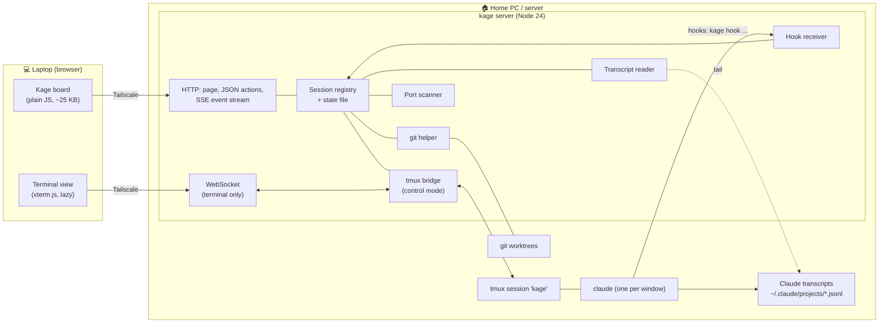

# Kage: design

Status: approved direction, 2026-11-21 (UI: Variant 1 "Quiet").
Visual target: [`docs/design/kage-board.html`](../design/kage-board.html) (open it in a browser and click through it), with screenshots in [`docs/design/reference/`](../design/reference/).
Earlier explorations, kept for history: [`docs/design/explorations/`](../design/explorations/).

## 1. What Kage is, and why

Kage is a small web app that runs on a developer's home PC or server. It lets them start, watch, answer and stop Claude Code sessions from a laptop, over Tailscale. Today the owner does this by SSH-ing in and juggling tmux windows by hand. Kage replaces that with one calm screen that shows what every session is doing and which ones are waiting for an answer.

**Who it's for:** developers who already run Claude Code on a machine that stays on.

**What matters most, in order:**
1. **Performance.** The page loads fast, updates instantly, and costs almost nothing on the server when nobody is looking.
2. **World-class UX** that matches the approved design exactly.
3. **A thin layer.** tmux, git and Claude Code stay the source of truth. Kage never hides them: `tmux attach` must always still work.

## 2. Goals, non-goals and anti-goals

**Goals (version 1, desktop):**
- List every Kage session, grouped as needs you, running and done, with live status.
- Show the selected session's recent output, updated live.
- Answer a waiting session with one click (its options as buttons), or with a typed reply.
- Start a task in a new git worktree and branch, from a chosen project and base branch.
- Stop a session. Pin, archive and delete finished ones, with a warning before unpushed work is lost.
- Show each session's open preview ports as links, and its changed files with a diff.
- Open a full interactive terminal for a session, loaded only on demand.
- Notify the developer when a session needs them (browser notification, optional ntfy).
- Run on boot as a service. Bind only to the Tailscale interface.

**Non-goals for version 1:**
- The phone layout. The design is desktop first; mobile comes later (see the explorations).
- A light theme. It may come later; Variant 2 in the explorations shows a direction.
- Multiple users, accounts or roles. One developer per installation.
- Hosting or a cloud service. Kage runs only on the developer's own machine.
- Managing tools other than Claude Code.

**Anti-goals (would count as failure even if it works):**
- A UI that is "in your face": glows, pulses, filled colour blocks, or several accents competing.
- Polling loops that burn CPU while nobody is watching.
- Any state that only Kage knows and that disagrees with tmux or git.
- Killing or changing tmux windows, worktrees or branches that Kage did not create.
- Reachable from the public internet or the local Wi-Fi by default.

## 3. Constraints

- **Platform:** Linux (primary, with systemd) and macOS. Windows through WSL only.
- **Runtime:** Node 24 LTS, built into the released `kage` program, so users don't install Node themselves. Node 20 reached end of life in April 2026.
- **Needs on the machine:** tmux 3.2 or newer, git 2.40 or newer, Claude Code, Tailscale.
- **Licence:** AGPL-3.0. Contributions need a CLA, because commercial licences may be sold.
- **Naming:** the product is "Kage"; avoid "Claude" in the product name (Anthropic's brand guidelines).
- **Build step allowed** (owner, 2026-11-21, replacing the brief's "no build step"): TypeScript throughout, built with esbuild. Performance and quality come first. See §5.1.
- **Easy install** (owner, 2026-11-21): one command installs Kage, checks the requirements, sets it up and starts it on boot. See §5.13.

## 4. Approaches considered

| Approach | What it is | Trade-off | Decision |
|---|---|---|---|
| **A. Terminal-first** | The browser is a tmux client: every session is a tab with a full terminal (xterm.js). | Full control and little UI work. But it loads ~110 KB on every visit and streams every byte, needs-you is hard to spot, and it's clumsy on a phone. | Rejected |
| **C. Dashboard first, terminal on demand** | A light dashboard of structured state. A full terminal is lazy-loaded only when you open it. | More UI and parsing work, but fast, calm and easy to answer from. | **Chosen by the owner** |

Within C, the owner compared six board designs (Current, Quiet, Daylight, Terminal UI, Conversation, Wall) and chose **Variant 1, "Quiet"**, refined through review comments into the version saved as the design target.

## 5. Architecture



### 5.1 Stack (builder's calls, recorded here)

- **Language:** TypeScript (`strict`) for the server, the CLI and the browser, in one pnpm workspace with shared types for the API and SSE events. `tsc --noEmit` checks types; **esbuild** builds.
- **Server:** Node 24. HTTP with [Hono](https://hono.dev) on `@hono/node-server`, which is small and fast. `ws` for the single WebSocket route. No native modules, so the server can ship as a single executable (§5.13). esbuild bundles it into one file.
- **Browser:** [Preact](https://preactjs.com) with `@preact/signals` (about 5 KB gzipped together), for fine-grained updates without re-rendering the board, and hand-written CSS using the tokens in §6.2. esbuild bundles and minifies it, and Kage serves the result with long-cache hashed file names, inlining the critical CSS. xterm.js is a separate chunk, loaded only when a terminal opens.
- **Fonts:** Geist and Geist Mono, self-hosted as subset woff2 files, preloaded, with `font-display: swap` and a system fallback stack.
- **State:** no database. tmux and git are the truth. One small JSON file, `~/.local/state/kage/state.json` (`$XDG_STATE_HOME`), holds what they can't: task text, project, base branch, created time, pinned, archived, and the tmux window IDs Kage created.
- **Tests:** vitest for units, real tmux for integration tests, and Playwright for end-to-end and visual tests (§8).
- **Tooling:** Biome for lint and format, pnpm.

### 5.2 Sessions

A **session** is one tmux window in the tmux session `kage` (configurable), plus Kage's record of it.

- **Created by Kage:** Kage runs `git worktree add <repo>/.worktrees/<slug> -b <branch> <base>`, then `tmux new-window -t kage -n <slug> -c <worktree>`, and starts `claude --settings <claude-settings.json> --permission-mode <mode> "<task>"` in it. The settings file is `$XDG_STATE_HOME/kage/claude-settings.json` (amended 2026-11-21, phase 2). Kage starts `claude` directly or through `exec`, never through a wrapper that stays alive: tmux reports the foreground process, and a wrapper would make the session look ended (amended 2026-11-21, phase 2).
- **Permission mode** (owner's ruling, 2026-11-21): Claude Code's default mode, so Claude asks before edits and commands, and Kage shows those prompts as amber questions with buttons. The New task form has an **"Accept edits automatically"** checkbox, which adds `--permission-mode acceptEdits` for that task. Kage always passes `--permission-mode` explicitly (`default` otherwise), because Claude Code 2.1.330 defaults to auto mode, which never prompts (amended 2026-11-21, phase 2). Commands still prompt. Kage never offers to skip permissions, and refuses a config value that would. Kage tags the window with a tmux user option, `@kage_id=<uuid>`, and the record stores that UUID with the window ID (`@12`). tmux reuses window IDs after a restart, so **ownership is the UUID**: a window counts as Kage's only if its `@kage_id` matches a record.
- **Found, not created:** windows in the `kage` session that Kage didn't create still appear, marked as *external*. Kage can show and answer them, but never stop or delete them. That's the brief's rule: "never kill windows you did not create".
- **Branch names:** `kage/<slug>` by default. The slug comes from the task text: lowercase, ASCII, at most 40 characters, made unique with a numeric suffix.
- **Worktree location:** `<repo>/.worktrees/<slug>` by default. Kage adds `.worktrees/` to the repo's `.git/info/exclude`, not to `.gitignore`, so it never changes tracked files. The location is configurable.

### 5.3 Status: how Kage knows what a session is doing

Kage starts each `claude` with a settings file whose hooks call `kage hook <event>`. That small CLI reads the hook's JSON from stdin and POSTs it to the server over a Unix socket (`$XDG_RUNTIME_DIR/kage.sock`, else `$XDG_STATE_HOME/kage/kage.sock`, else `~/.local/state/kage/kage.sock`), so hooks work even when the HTTP port is bound to Tailscale.

| Claude Code hook | Kage status | Extra data used |
|---|---|---|
| `SessionStart` | done: waiting for input (amended 2026-11-21, phase 2) | `session_id`, `transcript_path` (links the window to its transcript; every hook carries both, and any of them links) |
| `UserPromptSubmit` | running | none |
| `PreToolUse` / `PostToolUse` | running | the tool name feeds the "now doing" line; edits trigger a files refresh |
| `PostToolUseFailure` | running (the turn continues) | none |
| `PermissionRequest` | **needs you** (primary; fires within about 0.1 s) | the tool and its input |
| `Notification` (permission prompt) | **needs you** (fallback, only while a tool is pending) | the message |
| `Notification` (idle, "waiting for your input") | no change: stays done | ignored for status and never notifies |
| `Stop` | done (the turn finished; `claude` is still running and can take a follow-up) | triggers a files and ports refresh |
| `SessionEnd` | done (ended) | none |

Kage tells the two Notification kinds apart by the hook's `notification_type` field when present, and otherwise by its message text. Owner's ruling (2026-11-21): **only real questions and permission prompts turn a session amber**; a finished turn stays done.

**Done is not dead.** A done session still has `claude` waiting in its window, so the developer can give it a follow-up task (the reply box, or `R`); that sends the text and the session goes back to running. Archive also closes `claude` (kill-window) but keeps the worktree and branch.

A session whose `claude` process is gone, and whose window shows a shell prompt, counts as **ended**. In practice: the pane is dead, or its foreground command is a known shell (bash, zsh, sh, dash, fish, ksh and so on) (amended 2026-11-21, phase 2).

External windows without hooks fall back to activity: output in the last 5 seconds means running, and otherwise the status is unknown and shown as running without a cursor. The 5 s rule still applies, and a startup screen (below) overrides it (amended 2026-11-21, phase 2).

**Amendments from the phase 2 build** (2026-11-21, phase 2):

- **PermissionRequest is the needs-you trigger** (amended 2026-11-21, phase 2). It fires within about 0.1 s, while the permission `Notification` arrives about 11 s later. The `Notification` stays as a fallback, and counts only while a tool is pending (a `PreToolUse` or `PermissionRequest` with no `PostToolUse`, `PostToolUseFailure` or `Stop` since). It never turns a done or ended session amber again. `PostToolUseFailure` maps to running.
- **AskUserQuestion is recognised from `PreToolUse`** (amended 2026-11-21, phase 2): the tool name says it is a question, and `tool_input` holds the question and options.
- **Startup screens make a session needs-you** (amended 2026-11-21, phase 2). Claude's theme, security notes, folder-trust, renderer and login screens fire no hook. Kage reads them from the pane and shows the screen's text and options. The login screen has no options: Kage never answers it. Answering from the board comes in phase 3.
- **No or Esc fires no hook** (amended 2026-11-21, phase 2). The session leaves needs-you through the transcript's rejection record (a tool result with `toolDenialKind` "user-rejected", or user text starting "[Request interrupted by user"), or through the pane: the prompt is gone and the denial line ("Interrupted · What should Claude do instead?") is near the bottom. Either way the session is done.
- **Prompt cards show every option the prompt offers**, in order, with the trailing "· …" hint trimmed (amended 2026-11-21, phase 2). Hiding one, such as "Yes, and switch to auto mode", would put the button numbers out of step with Claude's.
- **SessionStart means waiting for input** (amended 2026-11-21, phase 2). A new or resumed session waits for its first prompt, so `SessionStart` maps to done (from ended too, for a resume). A task Kage launches still reads running at once, because `UserPromptSubmit` follows within about 0.6 s. The "now doing" line goes on the wire only while the session is running.
- **Any hook links the window** (amended 2026-11-21, phase 2). Every hook carries `session_id` and `transcript_path`, so the first hook Kage sees from a pane links it to its transcript, even when the `SessionStart` was missed (Kage restarted, or a hook was lost).
- **Startup checks are bounded** (amended 2026-11-21, phase 2). Kage looks for startup screens only in a window with no hook seen yet, and stops once Claude's idle input box shows. A `claude` window is captured once more a second after Kage first sees it, because a startup screen drawn after that sits still and makes no activity.
- **The placeholder window is hidden** (amended 2026-11-21, phase 2). The window `ensureSession` creates to hold the session open is tagged `@kage_placeholder` and left off the board while it sits at a shell. Once it runs anything else the tag is cleared and it shows like any window.

### 5.4 Output: what the session panel shows

The design shows Claude's prose in the sans font, tool calls as muted monospace lines, diffs in green and red, and a lime "thinking" line. To render that faithfully and cheaply, Kage reads **structure**, not screen text:

- **Transcript reader:** each Claude Code session writes a JSONL transcript (its path arrives with the `SessionStart` hook). Kage tails that file with `fs.watch` plus a size poll (§5.5) and turns new records into display lines: `say` (assistant text), `tool` (tool name and a short argument), `add` / `del` (edit diffs), `out` (short tool results, such as test summaries) and `think` (the current activity). It keeps the last 200 display lines per session in memory.
- **Questions:** when the latest assistant record is an `AskUserQuestion` tool call, its options become the answer buttons. For permission prompts (a `PermissionRequest` hook, or the `Notification` fallback), Kage reads the visible options from the pane (`tmux capture-pane -p`) and turns the numbered choices into buttons. If parsing fails, the typed reply box is always available.
- **Answering:** a button sends that option's number with `tmux send-keys -t <window> <n>`. A typed reply sends `send-keys -l -- "<text>"` followed by `Enter`.
- **Risk:** the transcript format is internal to Claude Code and may change. The reader is one module with recorded fixture files and tests, and if it fails to parse, Kage falls back to a plain monospace rendering of `capture-pane` text. Version 1 must work in fallback mode too.

### 5.5 Live updates

- **One SSE stream** (`GET /api/events`) per browser tab. The server pushes `snapshot` on connect, then small events: `session.updated` (status, counts, the "now doing" line), `session.lines` (new display lines, only for the session the tab has selected), `session.files`, `session.ports`, and `session.removed`. The `snapshot` carries a `streamId` for that tab and the `projectsRoot`, and its sessions carry no lines (`lines: []`) — lines come only through `session.lines` for the viewed session. The tab tells the server which session it's viewing with `POST /api/view {streamId, id}`; the server answers on that stream with `session.lines {id, lines, reset: true}` (the last 200 lines), then appends new lines as they arrive. A stream whose queue backs up (a stalled tab) is dropped; the tab reconnects and gets a fresh snapshot.
- **Nothing is polled while nobody watches.** Hooks and `fs.watch` drive everything. The only timers are the port scan (every 5 s, only while a tab is viewing a session that's running) and a 30 s heartbeat comment on the SSE stream. Two more timers are allowed (amended 2026-11-21, phase 2): `TranscriptTail` polls the file size every 2 s, and every 1 s while the file doesn't exist yet, because `fs.watch` misses events on WSL and network file systems. Pane captures (`capture-pane`) happen only for sessions a tab is viewing, apart from the prompt and startup-screen checks (amended 2026-11-21, phase 2). A pane fallback capture that continues the last one sends only the appended lines; a redrawn screen resets them. A `claude` window still in its startup checks gets one extra capture a second after Kage first sees it, and activity in a shell window re-lists at most once a second, because `pane_current_command` changes fire no tmux event (amended 2026-11-21, phase 2). Ended sessions keep their last transcript lines and get no further captures (amended 2026-11-21, phase 2).
- **Actions** are small JSON POSTs: new task, answer, reply, stop, pin, archive, delete. Each action returns at once, and its result arrives as an event.

### 5.6 The terminal view (lazy)

Opening Terminal (`T`) loads `xterm.js` the first time (about 90 KB gzipped, then cached) and opens `GET /api/sessions/:id/terminal` as a WebSocket.

- The **tmux bridge** keeps one tmux control-mode client (`tmux -C attach -t kage`) for the whole server. It receives `%output %<pane> <bytes>` events.
- When a terminal opens, the server sends the pane's current screen (`capture-pane -p -e -N`), then forwards that pane's `%output` bytes to the socket. Keystrokes come back as `send-keys -H <hex>`. Resizes use `refresh-client -C <w>x<h>` and `resize-window`.
- **Risk:** control-mode sizing and redraw. The plan starts with a spike to confirm that this works with Claude Code's interface. If it doesn't, the fallback is a per-terminal `tmux attach` through a pseudo-terminal.

### 5.7 Preview ports and changed files

- **Ports:** on Linux, `ss -ltnpH`; on macOS, `lsof -iTCP -sTCP:LISTEN -nP`. Kage keeps only the ports whose process is a descendant of the window's pane process (`#{pane_pid}`). Links point to `http://<tailscale-host>:<port>`. If a port listens only on 127.0.0.1, its card says "Only on this machine" and shows the `ssh -L` command instead of a link.
- **Files:** `git -C <worktree> status --porcelain=v2` and `git diff --numstat <base>...` refresh after edit hooks and `Stop`. View diff opens a read-only diff, rendered by Kage from `git diff <base>...`.

### 5.8 Finishing sessions

- **Stop:** `tmux kill-window -t <id>`, for windows Kage created only. The worktree and branch stay.
- **Pin:** a flag in the state file. Pinned sessions sort first in Done and are never archived automatically.
- **Archive:** closes `claude` if it's still running, and hides the session from the list, but keeps its worktree and branch. Archived sessions are listed under "Archived N" and can be restored. Done sessions are archived automatically once their branch is merged into the base (checked on `Stop` and every 10 minutes while the server runs), or after 14 days without a merge. Both settings are configurable, and pinned sessions are exempt.
- **Delete:** shows the confirmation from the design. If the branch has commits that aren't on its upstream or base, it warns "N commits aren't pushed and will be lost". Confirming runs kill-window (if alive), `git worktree remove --force` and `git branch -D`, and removes the record.

### 5.8a Restarts and reboots

- On start, Kage creates the tmux session `kage` if it's missing (`tmux new-session -d -s kage`), then reconciles: every window with a known `@kage_id` is re-linked, and every record without a live window becomes **ended**.
- An ended session keeps its worktree, branch and last output (from its transcript file). Its footer offers **Resume** on the left (it opens a new tagged window in the worktree and runs `claude --continue`) and Archive and Delete on the right.
- Kage never resumes sessions by itself after a reboot; the developer chooses which ones to resume.
- The systemd user unit starts Kage after the network and Tailscale are up. Kage owns starting the tmux session, so no tmux unit is needed.

### 5.9 Notifications

When a session moves to needs you, Kage sends a browser notification (Web Notifications, after the user allows them on the page) and, if `ntfyTopic` is set, a POST to ntfy. Clicking the notification opens that session.

### 5.10 Security

Kage can run commands on the machine, so the defaults are strict:
- **Network:** listen on the Tailscale IPv4 address only (from `tailscale ip -4`, or `host` in the config). Refuse to start on `0.0.0.0` unless `--unsafe-listen-all` is passed.
- **DNS rebinding:** reject requests whose `Host` header isn't the configured host name or IP.
- **CSRF:** every POST and WebSocket needs the header `X-Kage: 1` and a matching `Origin`.
- **Optional token:** `token` in the config. When set, a login page stores it in an `HttpOnly`, `SameSite=Strict` cookie.
- **Hook socket:** a Unix socket with `0600` permissions, owned by the user.
- **Shell safety:** all tmux and git calls use `execFile` with argument arrays, never a shell string. Task text reaches `claude` as a single argument.
- **Ownership:** stop, archive, delete and resume are refused unless the target window's `@kage_id` matches one of Kage's records (§5.2). Answer and reply also work on external windows.

### 5.11 Configuration

`~/.config/kage/config.json`:

```json
{
  "name": "my-pc",
  "projectsRoot": "~/projects",
  "host": "my-pc",
  "port": 8080,
  "tmuxSession": "kage",
  "worktreeDir": ".worktrees",
  "branchPrefix": "kage/",
  "autoArchive": { "onMerge": true, "afterDays": 14 },
  "ntfyTopic": "",
  "token": ""
}
```

`name` is the machine name shown in the host pill (default: the short host name). `host` is the address Kage listens on (default: the Tailscale IP). Projects are the git repositories directly inside `projectsRoot`. The New task picker defaults to the project used last and to that repo's default branch.

### 5.12 HTTP API

| Method and path | Purpose |
|---|---|
| `GET /` | The board (HTML, CSS and JS inlined or preloaded) |
| `GET /api/events` | SSE stream (§5.5) |
| `POST /api/view` | `{streamId, id}`: which session this tab shows (`id: null` for none) |
| `GET /api/projects` | Projects and their branches, for New task |
| `POST /api/sessions` | `{project, base, task, acceptEdits}`: start a task |
| `POST /api/sessions/:id/answer` | `{option}` (1–9) |
| `POST /api/sessions/:id/reply` | `{text}`: a typed answer, or a follow-up task for a done session |
| `POST /api/sessions/:id/stop` | Stop |
| `POST /api/sessions/:id/pin` | `{pinned}` |
| `POST /api/sessions/:id/archive` | `{archived}` |
| `DELETE /api/sessions/:id` | Delete (after the UI confirm) |
| `GET /api/sessions/:id/diff` | Unified diff against the base |
| `GET /api/sessions/:id/terminal` | WebSocket (§5.6) |
| `POST /hook` (Unix socket only) | Hook events from `kage hook` |

### 5.13 Install and distribution

**For users, one command:**

```sh
curl -fsSL https://raw.githubusercontent.com/eridian-io/kage/main/install.sh | sh
```

`install.sh` is a short POSIX shell script, readable before you run it. It:
1. detects the OS and CPU (Linux x64/arm64, macOS arm64/x64; on Windows it explains that WSL is required);
2. downloads the matching `kage` program from the latest GitHub Release and verifies its SHA-256 checksum against the release's `SHA256SUMS`;
3. installs it to `~/.local/bin/kage`, with no `sudo` (or `$KAGE_INSTALL_DIR`), and says how to add that folder to `PATH` if needed;
4. runs `kage setup`.

**`kage setup`** (interactive, and also usable later to change settings):
1. checks the requirements and says exactly what's missing, with the command to install it: tmux 3.2+, git 2.40+, Claude Code (signed in), Tailscale (up);
2. asks for the projects folder (it suggests `~/projects` or the folder that holds most git repos), confirms the Tailscale host name and port, and asks whether to set an access token;
3. writes `~/.config/kage/config.json`;
4. installs and starts a service: a systemd user unit on Linux (and offers `loginctl enable-linger`, so Kage runs without a login), or a launchd agent on macOS;
5. prints the address to open, for example `http://my-pc:8080`, and checks that it answers.

**Other commands:** `kage status` (the service, the address, the session count), `kage update` (downloads the latest release the same verified way, then restarts the service), `kage uninstall` (removes the service and the program; it keeps sessions, worktrees and the config unless `--purge` is given), and `kage doctor` (runs the requirement checks again).

**Release artifacts** (built by GitHub Actions for every tag `v*`):
- a single-executable `kage` for each platform, made with Node's single executable applications (SEA) from the esbuild bundle, with the UI files embedded as assets;
- `SHA256SUMS`, plus build provenance attestations;
- the npm package `@eridian-io/kage` as a second way in, for people who already use Node (`npm install -g @eridian-io/kage`, then `kage setup`).

**Risk:** SEA on macOS needs code signing (ad-hoc signing at least, and notarisation for a smooth first run). The plan starts with a spike that builds and runs a SEA binary on Linux and macOS. If it fails there, the fallback is the npm package with the same `kage setup`.

## 6. The UI, exactly as designed

The design target is the source of truth. Open `docs/design/kage-board.html`; where this text and the page disagree, the page wins.

### 6.1 Layout (desktop, at least 1100 px wide)

- **Top bar, 44 px:** the logo (`assets/kage-logo.png`, 22 px, rounded 6 px) and the off-white "kage" wordmark; the host pill "my-pc · N sessions" with a status dot; the counts "N needs you" (amber dot) and "N running" (lime dot); `⌘K` at the right.
- **Left column, 250 px:** "＋ New task  N" in lime; then the groups "needs you", "running" and "done" (lowercase labels). Each row shows `project /` in muted text, the task, and the age at the right. A waiting row adds the amber line "waiting for your reply". The selected row has a lime 2 px left edge. Pinned rows start with ★. Done shows pinned first.
- **Middle column (the session):**
  - Header: `project / task` at 18 px, with the status chip (amber "needs you", lime "running", grey "done"). Below it, the meta line in mono, `branch …   worktree …   started … ago`, with a short worktree path and the full path in a tooltip. A thin line underneath.
  - Output: display lines (§5.4) on the page background, with no box. A lime block cursor while running.
  - Question (when waiting): "Waiting for you" in amber, the question at 15 px, outlined option buttons with their number, and "or press R to reply".
  - Delete confirmation (when asked): a muted-red outlined panel with the paths, the unpushed warning, and "Delete session" and "Cancel".
  - Follow-up (done sessions): a quiet one-line field, "Follow up in this session…" with `R`, above the footer. Typing and pressing Enter sends the text and the session goes back to running.
  - Footer, always present: Terminal `T` on the left; on the right, Stop `X` (running or waiting), or Archive `E` and Delete… (done).
- **Right column, 250 px:** "Preview" with a card for each port (`:5173 vite` and a lime "Open ↗"), or "No ports open yet."; then "Files changed · N" with +/− counts and "View diff →".

### 6.2 Tokens

| Token | Value | Used for |
|---|---|---|
| `--bg` | `#0f1114` | page background |
| `--line` | `#1b1e23` | dividers |
| `--line-strong` | `#2a2f37` | button and chip outlines |
| `--fg` | `#c9ced6` | body text |
| `--fg-strong` | `#eef0f3` | titles, selected row, the wordmark |
| `--fg-2` | `#8a919c` | secondary text, meta values |
| `--fg-3` | `#5f6672` | labels, project prefixes, hints |
| `--lime` | `#cdf35a` | alive or actionable (§6.3) |
| `--amber` | `#d9a650` | needs you |
| `--red` | `#e08a8a` | Stop, Delete |
| `--add` / `--del` | `#9cc59f` / `#c98d8d` | diff lines and counts |
| Fonts | Geist 400/500/600/700, Geist Mono 400/500 | sans for prose and UI, mono for code, paths and meta |

### 6.3 Colour rules

- **Lime** only for what's alive or actionable: New task, the selected row's edge, the live cursor, the thinking line, preview links, the running chip, and hover states on links.
- **Amber** only for "needs you".
- **Muted red** only for Stop and Delete.
- The "kage" wordmark is never lime. No glows, pulses, gradients or filled colour blocks, except the solid red "Delete session" button inside the confirmation.

### 6.4 Keyboard

`N` new task · `J`/`K` next and previous session · `1`–`9` answer · `R` reply · `T` terminal · `X` stop · `S` pin · `E` archive · `Esc` closes the terminal, the dialog or the confirmation · `⌘K`/`Ctrl K` command palette (version 1: jump to a session, new task). Shortcuts are ignored while typing in a field.

### 6.5 States the design doesn't show (builder's calls)

- **First run with no sessions:** the middle column says "No sessions yet" and offers the New task form with a short explanation.
- **New task:** clicking New task turns the left column's top into a form (task text, Project ▾, Branch off ▾, an "Accept edits automatically" checkbox, Start). `Enter` starts it, and `Esc` cancels.
- **Server unreachable:** a thin bar under the top bar says "Reconnecting to my-pc…". The UI stays readable, and actions are disabled until the connection is back.
- **Terminal open:** the output area becomes the terminal, and its footer shows "Back to session  Esc".
- **Diff view:** it replaces the output area with a read-only unified diff, using the same Back pattern.
- **Ended session** (after a reboot, or when `claude` exited): the chip says "ended" in grey. The footer shows Resume `U` on the left, and Archive `E` and Delete… on the right.

## 7. Performance budgets

These are checked in CI (§8):
- **First load:** HTML, CSS and JS at most **30 KB gzipped**, not counting fonts and the logo. Fonts are at most 60 KB (two woff2 subsets).
- **Time to a usable board:** under **300 ms** on the tailnet (LAN), measured from navigation to the first `snapshot` being rendered.
- **Hook to screen:** a status change appears in the browser within **150 ms** of the hook firing.
- **Idle server:** less than 1% CPU and under 80 MB RSS with 10 sessions and no tab open.
- **Rendering:** new output lines are appended, never a full re-render. Long outputs keep at most 500 nodes in the DOM.
- **Terminal:** loaded only on demand (about 90 KB gzipped, once).

## 8. Making sure it matches the design

- **Demo mode:** `kage --demo` serves the exact sample sessions from the design target (the same data object), with no tmux needed.
- **Visual tests:** Playwright renders the design target in frameless mode (`kage-board.html#full`) and the app in demo mode, both at 1320×900 and scale 1, in the same browser. Google Fonts requests from the target are redirected to the app's own self-hosted Geist files, so both use identical fonts. The test drives both to four states (needs you, running, done, the delete confirmation) and compares the two screenshots pixel by pixel; more than 0.5% differing pixels fails. Comparing live, rather than against stored images, means operating-system font rendering can't cause false failures. The screenshots in `docs/design/reference/` are the human-readable record of the same states. Changing the design means updating the target page and the screenshots in the same pull request.
- **Token test:** a unit test checks that `public/kage.css` defines every token in §6.2 with the listed value.
- **Behaviour tests:** end-to-end tests drive a fake `claude` (a script that fires the same hooks, writes a transcript fixture, and prints a numbered question), with real tmux and git, through: start a task, see running, see needs you, answer, see done, delete.
- **Budget tests:** a script measures the gzipped size of the first load and fails over budget, and a test measures hook-to-screen time.

## 9. Delivery in phases

The phases follow the owner's whiteboard. Each phase ends with a check that proves it works.
1. **Skeleton:** the server, config, Tailscale bind and security checks, and the board UI in demo mode, pixel-matched to the target. Check: the visual tests pass, and the board loads over Tailscale.
2. **Sessions:** the tmux bridge, hooks, transcript reader and SSE. Check: a Claude session started by Kage appears with live status and output.
3. **Control:** new task (worktree), answer, reply, stop, ports and files. Check: start, answer and stop a task from the laptop.
4. **Finish and terminal:** pin, archive, auto-archive, delete with warning, diff view, and the lazy terminal. Check: the full lifecycle, and the terminal works with Claude's interface.
5. **Polish:** notifications, the command palette, and the budget checks. Check: Kage pings the phone, and every budget in §7 passes.
6. **Install and release:** `kage setup`, `status`, `update`, `uninstall` and `doctor`; the systemd and launchd services; `install.sh`; SEA builds, checksums and the npm package in a release workflow. Check: on a clean Linux machine and a clean Mac, the one-line install leads to a working board, and Kage survives a reboot.

## 10. Left to the builder

- Exact copy for empty and error states, following the tone of the design.
- The internal module layout, as long as the transcript reader and the tmux bridge stay isolated behind small interfaces.
- How to vendor and subset fonts and xterm.js.
- Keyboard focus styling (visible, using lime at low opacity), within the colour rules.

## 11. Decisions from review (2026-11-21)

An independent builder check raised five questions. The owner answered two; the rest were settled as builder's calls:
- **Done sessions** (owner): they can take a follow-up; the idle notification never turns them amber; Archive closes `claude` (§5.3, §5.8, §6.1).
- **Permission mode** (owner): Claude Code's default, plus a per-task "Accept edits automatically" checkbox; never skip permissions (§5.2).
- **Build and install** (owner, later the same day): the "no build step" rule is dropped. TypeScript throughout, built with esbuild. A one-line installer sets Kage up as a service, and releases ship a single executable per platform plus an npm package (§3, §5.1, §5.13).
- **Restarts** (builder): windows are tagged with `@kage_id`; dead sessions become ended, with Resume on request (§5.2, §5.8a).
- **Reference screenshots** (builder): recaptured frameless at 1320×900 from `kage-board.html#full` (§8).

Auto-archive defaults (on merge, plus 14 days) are the builder's call and are configurable. Nothing else is open.
