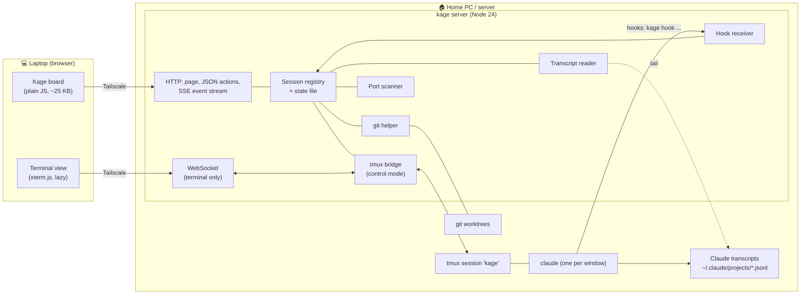

# Kage: design

Status: approved direction, 2026-11-21 (UI: Variant 1 "Quiet").
Visual target: [`docs/design/kage-board.html`](../design/kage-board.html) (open it in a browser and click through it), with screenshots in [`docs/design/reference/`](../design/reference/).
Earlier explorations, kept for history: [`docs/design/explorations/`](../design/explorations/).

## 1. What Kage is, and why

Kage is a small web app that runs on a developer's home PC or server. It lets them start, watch, answer and stop Claude Code sessions from a laptop, over Tailscale. Today the owner does this by SSH-ing in and juggling tmux windows by hand. Kage replaces that with one calm screen that shows what every session is doing and which ones are waiting for an answer.

**Who it's for:** developers who already run Claude Code on a machine that stays on.

**What matters most, in order:**
1. **Performance.** The page loads fast, updates instantly, and costs almost nothing on the server when nobody is looking.
2. **World-class UX** that matches the approved design exactly.
3. **A thin layer.** tmux, git and Claude Code stay the source of truth. Kage never hides them: `tmux attach` must always still work.

## 2. Goals, non-goals and anti-goals

**Goals (version 1, desktop):**
- List every Kage session, grouped as needs you, running and done, with live status.
- Show the selected session's recent output, updated live.
- Answer a waiting session with one click (its options as buttons), or with a typed reply.
- Start a task in a new git worktree and branch, from a chosen project and base branch.
- Stop a session. Pin, archive and delete finished ones, with a warning before unpushed work is lost.
- Show each session's open preview ports as links, and its changed files with a diff.
- Open a full interactive terminal for a session, loaded only on demand.
- Notify the developer when a session needs them (browser notification, optional ntfy).
- Run on boot as a service. Bind only to the Tailscale interface.

**Non-goals for version 1:**
- The phone layout. The design is desktop first; mobile comes later (see the explorations).
- A light theme. It may come later; Variant 2 in the explorations shows a direction.
- Multiple users, accounts or roles. One developer per installation.
- Hosting or a cloud service. Kage runs only on the developer's own machine.
- Managing tools other than Claude Code.

**Anti-goals (would count as failure even if it works):**
- A UI that is "in your face": glows, pulses, filled colour blocks, or several accents competing.
- Polling loops that burn CPU while nobody is watching.
- Any state that only Kage knows and that disagrees with tmux or git.
- Killing or changing tmux windows, worktrees or branches that Kage did not create.
- Reachable from the public internet or the local Wi-Fi by default.

## 3. Constraints

- **Platform:** Linux (primary, with systemd) and macOS. Windows through WSL only.
- **Runtime:** Node 24 LTS, built into the released `kage` program, so users don't install Node themselves. Node 20 reached end of life in April 2026. As built (amended 2026-11-22, phase 6): the release Node is the version in `.node-version` (24.22.3). The release workflow builds every executable from that Node, fetched from nodejs.org and checked against its signed `SHASUMS256.txt`. The npm package and a checkout need Node 24.2 or newer.
- **Needs on the machine:** tmux 3.2 or newer, git 2.40 or newer, Claude Code, Tailscale.
- **Licence:** AGPL-3.0. Contributions need a CLA, because commercial licences may be sold.
- **Naming:** the product is "Kage"; avoid "Claude" in the product name (Anthropic's brand guidelines).
- **Build step allowed** (owner, 2026-11-21, replacing the brief's "no build step"): TypeScript throughout, built with esbuild. Performance and quality come first. See §5.1.
- **Easy install** (owner, 2026-11-21): one command installs Kage, checks the requirements, sets it up and starts it on boot. See §5.13.

## 4. Approaches considered

| Approach | What it is | Trade-off | Decision |
|---|---|---|---|
| **A. Terminal-first** | The browser is a tmux client: every session is a tab with a full terminal (xterm.js). | Full control and little UI work. But it loads ~110 KB on every visit and streams every byte, needs-you is hard to spot, and it's clumsy on a phone. | Rejected |
| **C. Dashboard first, terminal on demand** | A light dashboard of structured state. A full terminal is lazy-loaded only when you open it. | More UI and parsing work, but fast, calm and easy to answer from. | **Chosen by the owner** |

Within C, the owner compared six board designs (Current, Quiet, Daylight, Terminal UI, Conversation, Wall) and chose **Variant 1, "Quiet"**, refined through review comments into the version saved as the design target.

## 5. Architecture



### 5.1 Stack (builder's calls, recorded here)

- **Language:** TypeScript (`strict`) for the server, the CLI and the browser, in one pnpm workspace with shared types for the API and SSE events. `tsc --noEmit` checks types; **esbuild** builds.
- **Server:** Node 24. HTTP with [Hono](https://hono.dev) on `@hono/node-server`, which is small and fast. `ws` for the single WebSocket route. No native modules, so the server can ship as a single executable (§5.13). esbuild bundles it into one file.
- **Browser:** [Preact](https://preactjs.com) with `@preact/signals` (about 5 KB gzipped together), for fine-grained updates without re-rendering the board, and hand-written CSS using the tokens in §6.2. esbuild bundles and minifies it, and Kage serves the result with long-cache hashed file names, inlining the critical CSS. xterm.js is a separate chunk, loaded only when a terminal opens. As built (amended 2026-11-22, phase 4): `@xterm/xterm` 6.0.0 with `@xterm/addon-fit` 0.11.0 in the browser, and `ws` pinned at exactly 8.23.0 on the server (8.22.2 has a remote memory-exhaustion DoS that 8.23.0 fixes, so the two-week age rule yielded to the fix: R62). The terminal is its own esbuild entry, `term-[hash].js` and `term-[hash].css`. Only a `<meta name="kage-term">` in the page names it, and a loader of about 390 bytes in the main bundle fetches it, so it costs nothing until `T` is pressed.
- **Fonts:** Geist and Geist Mono, self-hosted as subset woff2 files, preloaded, with `font-display: swap` and a system fallback stack. As built (amended 2026-11-22, phase 5): two **variable** woff2 files, one per family, replace the six static ones, 59,296 B in all (72,968 B before), with their OFL licence texts in `dist/fonts/`. The pixel difference to the static files is at most 0.009%.
- **Code splitting** (amended 2026-11-22, phase 5): the board is built with esbuild's `splitting`. Code that `app` shares with a lazy entry goes into `chunk-[hash].js` files, which `index.html` names with `<link rel="modulepreload">` so they load with `app`. The diff view (`diff-[hash].js`) and the command palette (`palette-[hash].js`) are lazy entries, loaded on first use and named in a `<meta name="kage-…">` for a retry; the terminal stays its own build (`term-…`). A build test checks that a lazy entry imports only files that are already in the first load.
- **State:** no database. tmux and git are the truth. One small JSON file, `~/.local/state/kage/state.json` (`$XDG_STATE_HOME`), holds what they can't: task text, project, base branch, permission mode, created time, pinned, archived, and the tmux window IDs Kage created. The record gains `base` (the branch the task was cut from) and `permissionMode` (`default` or `acceptEdits`). (amended 2026-11-21, phase 3). It gains `baseCommit` (the commit the worktree was cut from, a full 40- or 64-digit hex id; null for older records), `doneAt` (epoch ms of the last move into done or ended; null while active), `archivedAt`, `restoredAt` and `unpinnedAt` (epoch ms; the last two restart auto-archive's clock, §5.8) (amended 2026-11-22, phase 4).
- **Tests:** vitest for units, real tmux for integration tests, and Playwright for end-to-end and visual tests (§8).
- **Tooling:** Biome for lint and format, pnpm.

### 5.2 Sessions

A **session** is one tmux window in the tmux session `kage` (configurable), plus Kage's record of it.

- **Created by Kage:** Kage runs `git worktree add <repo>/.worktrees/<slug> -b <branch> <base>`, then `tmux new-window -t kage -n <slug> -c <worktree>`, and starts `claude --settings <claude-settings.json> --permission-mode <mode> "<task>"` in it. The settings file is `$XDG_STATE_HOME/kage/claude-settings.json` (amended 2026-11-21, phase 2). Kage starts `claude` directly or through `exec`, never through a wrapper that stays alive: tmux reports the foreground process, and a wrapper would make the session look ended (amended 2026-11-21, phase 2).
- **Permission mode** (owner's ruling, 2026-11-21): Claude Code's default mode, so Claude asks before edits and commands, and Kage shows those prompts as amber questions with buttons. The New task form has an **"Accept edits automatically"** checkbox, which adds `--permission-mode acceptEdits` for that task. Kage always passes `--permission-mode` explicitly (`default` otherwise), because Claude Code 2.1.330 defaults to auto mode, which never prompts (amended 2026-11-21, phase 2). Commands still prompt. Kage never offers to skip permissions, and refuses a config value that would. Kage tags the window with a tmux user option, `@kage_id=<uuid>`, and the record stores that UUID with the window ID (`@12`). tmux reuses window IDs after a restart, so **ownership is the UUID**: a window counts as Kage's only if its `@kage_id` matches a record.
- **Starting a task, as built** (amended 2026-11-21, phase 3):
  - **Command.** Kage runs `claude --settings <file> --permission-mode <default|acceptEdits> -- "<task>"`. The `--` ends the options, so a task can't be read as a flag. The argv never holds another mode or `--dangerously-skip-permissions`. `claude` is `KAGE_CLAUDE_BIN` (a path, or a name looked up on `PATH`), else the first `claude` on `PATH`. With none, the start fails with 503.
  - **Direct launch.** `tmux new-window -d -P -F '#{window_id}<tab>#{pane_id}' -t <session> -n <slug> -c <worktree> -e KAGE_SOCKET=<socket> -e PATH=<Kage's PATH> -- <argv>`. `<tab>` is a tab character: tmux prints the new window's ID and its pane's ID on one line, and Kage checks both. There is no shell in between, so the window closes when Claude exits. The session then counts as ended; the worktree and branch stay.
  - **Tagging.** The window is tagged `@kage_id` in a second tmux call on its window ID, never chained with `;` in the same call: the chained form tagged the wrong window. Kage writes the record first (`adopt`), and the window then `claim`s it, so the tag and the record can't be separated.
  - **Slugs.** Lowercase ASCII from the task text, at most 40 characters, made unique against the project's branches and Kage's own records (a numeric suffix).
  - **Exclude entry.** Kage adds `/<worktreeDir>/` to the repo's `info/exclude`, found with `git rev-parse --git-path info/exclude`. A relative answer is resolved against the repo's git directory.
  - **Rollback.** If the worktree, the window or the launch check fails, Kage removes only what this request created: its window, worktree, branch and record. It never deletes a branch that existed before. After the launch it checks that the folder exists and that the window and its pane are still alive 250 ms later, else it answers 422. The 422 names the step that failed: "The worktree folder is missing.", "Kage couldn't save the session: …" or "tmux couldn't open a window: …". If `new-window` itself fails (a timeout can come after tmux opened the window), Kage lists the windows named after the slug and kills any that wasn't there before the launch and is untagged (or tagged with this launch's id), before it removes the worktree. tmux re-reads the tag just before each kill.
  - **One at a time per project.** Starts for the same project run one after another, so two identical tasks get distinct names. A project is keyed by its real folder, so a symlink or a differently-cased name shares the lock.
- **Found, not created:** windows in the `kage` session that Kage didn't create still appear, marked as *external*. Kage can show and answer them, but never stop or delete them. That's the brief's rule: "never kill windows you did not create".
- **Branch names:** `kage/<slug>` by default. The slug comes from the task text: lowercase, ASCII, at most 40 characters, made unique with a numeric suffix.
- **Worktree location:** `<repo>/.worktrees/<slug>` by default. Kage adds `.worktrees/` to the repo's `.git/info/exclude`, not to `.gitignore`, so it never changes tracked files. The location is configurable.

### 5.3 Status: how Kage knows what a session is doing

Kage starts each `claude` with a settings file whose hooks call `kage hook <event>`. That small CLI reads the hook's JSON from stdin and POSTs it to the server over a Unix socket (`$XDG_RUNTIME_DIR/kage.sock`, else `$XDG_STATE_HOME/kage/kage.sock`, else `~/.local/state/kage/kage.sock`), so hooks work even when the HTTP port is bound to Tailscale.

| Claude Code hook | Kage status | Extra data used |
|---|---|---|
| `SessionStart` | done: waiting for input (amended 2026-11-21, phase 2) | `session_id`, `transcript_path` (links the window to its transcript; every hook carries both, and any of them links) |
| `UserPromptSubmit` | running | none |
| `PreToolUse` / `PostToolUse` | running | the tool name feeds the "now doing" line; edits trigger a files refresh |
| `PostToolUseFailure` | running (the turn continues) | none |
| `PermissionRequest` | **needs you** (primary; fires within about 0.1 s) | the tool and its input |
| `Notification` (permission prompt) | **needs you** (fallback, only while a tool is pending) | the message |
| `Notification` (idle, "waiting for your input") | no change: stays done | ignored for status and never notifies |
| `Stop` | done (the turn finished; `claude` is still running and can take a follow-up) | triggers a files and ports refresh |
| `SessionEnd` | done (ended) | none |

Kage tells the two Notification kinds apart by the hook's `notification_type` field when present, and otherwise by its message text. Owner's ruling (2026-11-21): **only real questions and permission prompts turn a session amber**; a finished turn stays done.

**Done is not dead.** A done session still has `claude` waiting in its window, so the developer can give it a follow-up task (the reply box, or `R`); that sends the text and the session goes back to running. Archive also closes `claude` (kill-window) but keeps the worktree and branch.

A session whose `claude` process is gone, and whose window shows a shell prompt, counts as **ended**. In practice: the pane is dead, or its foreground command is a known shell (bash, zsh, sh, dash, fish, ksh and so on) (amended 2026-11-21, phase 2).

External windows without hooks fall back to activity: output in the last 5 seconds means running, and otherwise the status is unknown and shown as running without a cursor. The 5 s rule still applies, and a startup screen (below) overrides it (amended 2026-11-21, phase 2).

**Amendments from the phase 2 build** (2026-11-21, phase 2):

- **PermissionRequest is the needs-you trigger** (amended 2026-11-21, phase 2). It fires within about 0.1 s, while the permission `Notification` arrives about 11 s later. The `Notification` stays as a fallback, and counts only while a tool is pending (a `PreToolUse` or `PermissionRequest` with no `PostToolUse`, `PostToolUseFailure` or `Stop` since). It never turns a done or ended session amber again. `PostToolUseFailure` maps to running.
- **AskUserQuestion is recognised from `PreToolUse`** (amended 2026-11-21, phase 2): the tool name says it is a question, and `tool_input` holds the question and options.
- **Startup screens make a session needs-you** (amended 2026-11-21, phase 2). Claude's theme, security notes, folder-trust, renderer and login screens fire no hook. Kage reads them from the pane and shows the screen's text and options. The login screen has no options: Kage never answers it. The board answers them since phase 3 (§5.4), except the login screen.
- **No or Esc fires no hook** (amended 2026-11-21, phase 2). The session leaves needs-you through the transcript's rejection record (a tool result with `toolDenialKind` "user-rejected", or user text starting "[Request interrupted by user"), or through the pane: the prompt is gone and the denial line ("Interrupted · What should Claude do instead?") is near the bottom. Either way the session is done.
- **Prompt cards show every option the prompt offers**, in order, with the trailing "· …" hint trimmed (amended 2026-11-21, phase 2). Hiding one, such as "Yes, and switch to auto mode", would put the button numbers out of step with Claude's.
- **SessionStart means waiting for input** (amended 2026-11-21, phase 2). A new or resumed session waits for its first prompt, so `SessionStart` maps to done (from ended too, for a resume). A task Kage launches still reads running at once, because `UserPromptSubmit` follows within about 0.6 s. The "now doing" line goes on the wire only while the session is running.
- **Any hook links the window** (amended 2026-11-21, phase 2). Every hook carries `session_id` and `transcript_path`, so the first hook Kage sees from a pane links it to its transcript, even when the `SessionStart` was missed (Kage restarted, or a hook was lost).
- **Startup checks are bounded** (amended 2026-11-21, phase 2). Kage looks for startup screens only in a window with no hook seen yet, and stops once Claude's idle input box shows. A `claude` window is captured once more a second after Kage first sees it, because a startup screen drawn after that sits still and makes no activity.
- **The placeholder window is hidden** (amended 2026-11-21, phase 2). The window `ensureSession` creates to hold the session open is tagged `@kage_placeholder` and left off the board while it sits at a shell. Once it runs anything else the tag is cleared and it shows like any window.

**Amendments from the phase 3 build** (2026-11-21, phase 3):

- **A task Kage launches stays running until its first prompt** (amended 2026-11-21, phase 3). After the trust screen, Claude's `SessionStart` came about a second before the task's own `UserPromptSubmit`, so a launched task blinked done, and a reply sent in that blink was queued while Claude started. Now a session Kage started (`adopt`) that hasn't taken its first prompt keeps running ("Starting Claude…") through a non-compact `SessionStart`. The wait ends at the first `UserPromptSubmit`, `PreToolUse` or `SessionEnd`. If none comes within 10 s of the `SessionStart`, the wait ends, and when the pane shows Claude's idle box without "esc to interrupt" the session is done. A startup screen meanwhile shows as needs-you as before, and doesn't end the wait.
- **`SessionStart` with source `compact` keeps the status** (amended 2026-11-21, phase 3). Claude compacts its context mid-turn and fires `SessionStart` again. Kage ignores that one for status, so a running session doesn't flip to done.
- **A placeholder window gets the socket too** (amended 2026-11-21, phase 3). `kage serve` sets `KAGE_SOCKET` on the tmux session with `new-session -e` and `set-environment`, so a `claude` started by hand in a later window finds the same hook socket.
- **Bidi and format characters are stripped from all displayed text** (amended 2026-11-21, phase 3) (say, out, pane lines and plain text), so text can't read differently from what it is.

**Amendments from the phase 4 build** (amended 2026-11-22, phase 4):

- **The first-prompt fallback decides on the busy footer alone** (R57, (amended 2026-11-22, phase 4)). The 10 s fallback of the phase 3 rule captures the pane, and the session is done unless the capture shows Claude's busy footer ("esc to interrupt"). The idle box no longer has to show. If the capture fails twice in a row, the session is done too (R58): a wrong done corrects itself at the next hook, while a wrong running could stay.
- **A launch is never done before its first hook** (P4F1, amended 2026-11-22, phase 4). Before Claude's first hook, a session Kage launched or resumed is in activity mode, and its 5 s idle rule would call a quiet pane done, though Claude may be drawing the folder-trust screen just after the last capture. So until the first hook (or the idle input box shows), the idle rule captures the pane instead: a startup screen is needs-you with its question, and anything else stays running, "Starting Claude…", and is captured again a second later. Activity keeps triggering the startup-screen check as before, and the window's end still ends the wait.
- **Resume uses the same fallback** (R57, F6, (amended 2026-11-22, phase 4)). A resumed session reads running, "Starting Claude…", until its first `UserPromptSubmit`, `PreToolUse` or `SessionEnd`, or until the 10 s fallback. A resumed session takes no first prompt, so it normally reaches done through the fallback. An unknown `--resume` id exits at once and fires a `SessionEnd` with a new, random `session_id` and no `SessionStart` (integration §8): Kage treats that as a failed resume, and the record keeps its old id.
- **Known gap** (backlog B34): a resumed window that dies before Kage's first listing of it loses that `SessionEnd`.

### 5.4 Output: what the session panel shows

The design shows Claude's prose in the sans font, tool calls as muted monospace lines, diffs in green and red, and a lime "thinking" line. To render that faithfully and cheaply, Kage reads **structure**, not screen text:

- **Transcript reader:** each Claude Code session writes a JSONL transcript (its path arrives with the `SessionStart` hook). Kage tails that file with `fs.watch` plus a size poll (§5.5) and turns new records into display lines: `say` (assistant text), `tool` (tool name and a short argument), `add` / `del` (edit diffs), `out` (short tool results, such as test summaries) and `think` (the current activity). It keeps the last 200 display lines per session in memory.
- **Questions:** when the latest assistant record is an `AskUserQuestion` tool call, its options become the answer buttons. For permission prompts (a `PermissionRequest` hook, or the `Notification` fallback), Kage reads the visible options from the pane (`tmux capture-pane -p`) and turns the numbered choices into buttons. If parsing fails, the typed reply box is always available.
- **Answering:** a button sends that option's number with `tmux send-keys -t <window> <n>`. A typed reply sends `send-keys -l -- "<text>"` followed by `Enter`. As built, the details are these (amended 2026-11-21, phase 3):
  - **Plans.** Permission prompts and AskUserQuestion take the option's digit alone (a digit submits at once; no Enter). The folder-trust screen has no digits: Kage reads the `❯` from the pane, sends `Down` or `Up` presses to reach the chosen option, looks again (up to 10 times) until the `❯` is there, and only then sends `Enter`. If the `❯` never gets there, or the screen is gone, it sends nothing more and answers 409. The login screen is never answered.
  - **Screen check before every key.** Kage captures the pane and sends a key only if the same prompt is still showing. The request carries the question text the user saw (`{option, question}`). If the question has changed, the answer is 409 "The question changed. Look again before answering." A click meant for one prompt never approves another.
  - **The whole command is compared.** A permission prompt's question text holds the command up to the 500-character question bound, joined from Claude's wrapped lines, and the card wraps it. Two commands that start alike are different questions. When the command is longer than the bound, the card adds "… see the terminal for the full command".
  - **A new question waits a moment.** When the selected session's question changes (its text or options), its buttons are disabled and the digit keys do nothing for about 800 ms, so a key or click meant for the old question can't answer the new one.
  - **After an answer.** The session goes to running at once, and one pane capture 500 ms later decides what came next: another prompt or startup screen means needs-you with that question, and Claude's denial line under the tool means done (the answer was No). A status change in between cancels that check.
  - **Refused options.** "Yes, and switch to auto mode" is disabled, because it changes the launch permission policy. So is the renderer screen's "Yes, try it". "Yes, and switch to accept edits" stays enabled: accept-edits is the owner's sanctioned mode (§11), and picking it is an explicit act. A multi-select question is answered in the terminal.
  - **A reply at a prompt is `Escape`, then the text.** Escape declines the prompt ("What should Claude do instead?"), Kage waits for Claude's idle input box, and then types the text.
  - **Enter only after the text shows.** Kage types the text in one `send-keys -l --` call (up to 12,000 bytes, chunked on whole characters above that), reads the input box, and sends `Enter` only when the box shows the text (or Claude's `[Pasted text #N` placeholder, for text over 800 UTF-16 units). Otherwise it answers 409 "Your text is still in Claude's input box; send or clear it in the terminal." Kage never sends `Ctrl+U` or a double `Escape` to clear: a double `Escape` on an empty box opens Claude's rewind menu. That is Claude's documented behaviour; the phase 3 spike didn't reproduce it (claude-code-integration.md §7, "Clearing typed text"), and Kage still never sends it.
  - **A reply can't start with `!`, `#`, `/` or a digit 1–9.** `!` runs a shell command with no prompt, `#` writes memory, `/` is a slash command, and a digit could answer a prompt that appears mid-send. A reply holds no control character or line break.
  - **Interrupt suppression.** For 5 s from the reply's `Escape` (the window starts just before Kage sends it), Kage ignores the "[Request interrupted" and denial-line signals of §5.3, so the Escape that is part of a reply doesn't read as a user cancel.
  - **No pre-trusting** (owner's ruling). Kage never writes Claude's configuration to skip the trust screen. Claude trusts the folders below a trusted repo, so the screen shows only for a project that was never trusted, and the board answers it.
- **Risk:** the transcript format is internal to Claude Code and may change. The reader is one module with recorded fixture files and tests, and if it fails to parse, Kage falls back to a plain monospace rendering of `capture-pane` text. Version 1 must work in fallback mode too.

### 5.5 Live updates

- **One SSE stream** (`GET /api/events`) per browser tab. (amended 2026-11-22, phase 5): a change to a session's "now doing" line alone goes out at most **4 times a second per session** (250 ms, with a trailing edge that carries the latest state). Any other visible change (status, question, counts) goes out at once and takes the pending now-line update with it, so a prompt never waits. The server pushes `snapshot` on connect, then small events: `session.updated` (status, counts, the "now doing" line), `session.lines` (new display lines, only for the session the tab has selected), `session.files`, `session.ports`, and `session.removed`. (amended 2026-11-22, phase 4): an `archive {count}` event carries the number of archived sessions whenever it changes, and the `snapshot` carries `archived`, the same number (the list itself is `GET /api/archive`). The `snapshot` carries a `streamId` for that tab and the `projectsRoot`, and its sessions carry no lines (`lines: []`) — lines come only through `session.lines` for the viewed session. The tab tells the server which session it's viewing with `POST /api/view {streamId, id}`; the server answers on that stream with `session.lines {id, lines, reset: true}` (the last 200 lines), then appends new lines as they arrive. A stream whose queue backs up (a stalled tab) is dropped; the tab reconnects and gets a fresh snapshot.
- **Nothing is polled while nobody watches.** Hooks and `fs.watch` drive everything. The only timers are the port scan (every 5 s, only while a tab is viewing a session that's running) and a 30 s heartbeat comment on the SSE stream. Two more timers are allowed (amended 2026-11-21, phase 2): `TranscriptTail` polls the file size every 2 s, and every 1 s while the file doesn't exist yet, because `fs.watch` misses events on WSL and network file systems. Pane captures (`capture-pane`) happen only for sessions a tab is viewing, apart from the prompt and startup-screen checks (amended 2026-11-21, phase 2). A pane fallback capture that continues the last one sends only the appended lines; a redrawn screen resets them. A `claude` window still in its startup checks gets one extra capture a second after Kage first sees it, and activity in a shell window re-lists at most once a second, because `pane_current_command` changes fire no tmux event (amended 2026-11-21, phase 2). Ended sessions keep their last transcript lines and get no further captures (amended 2026-11-21, phase 2). (amended 2026-11-22, phase 5): the **notifier** (§5.9) owns three kinds of timer, and only while there is something to wait for: one per session, for the 3 s hold before a ping, or, for a needs-you inside the 120 s quiet period, the wait for the period's end (R94); the ntfy client's retry waits (2 s, 8 s, 30 s, or a 429's `Retry-After` up to 60 s) and its 5 s request timeout, one set per ping in flight; and one timer for the "skipped N" log line while the global ping window is full. With nothing pending it owns none. (amended 2026-11-23, hardening): the **login store** (§5.10) holds one timer, set for the earliest moment a login session can expire, and only while there are sessions. When it fires it ends the sessions that have expired, which closes their streams and terminals, and sets itself for the next deadline. It is a deadline, not a poll: with one login in use it fires about once a week. The web side has no timers: the title count and the notifications run on events.
- **Actions** are small JSON POSTs: new task, answer, reply, stop, pin, archive, delete. Each action returns at once, and its result arrives as an event. **Except delete** (amended 2026-11-22, phase 4): `DELETE /api/sessions/:id` waits for the removal and answers 204 after it, so a failure can say why (B10). **Except new task** (amended 2026-11-21, phase 3): `POST /api/sessions` waits for `git worktree add` (up to 60 s) and the window launch, then answers 201 with the session's id. It is synchronous so that a failure can say why and roll back.
- **Ports and files** (amended 2026-11-21, phase 3): `session.ports` and `session.files` go out for the viewed session on every refresh, also when empty or unchanged, and in the reconnect snapshot, so a held value never goes stale. The port scan runs while a tab views a session that is **running or needs you** (the spec said running only; a dev server stays up while Claude waits for an answer), every 5 s, and once at a turn end. Caps: 100 files per session (`session.files` also carries the total), and line counts are read for at most 100 untracked files. (amended 2026-11-22, phase 5): the line counts of untracked files are cached by worktree and path, valid while the file's size and mtime are unchanged (B37), at most 2,000 entries, least recently used first. An entry recorded less than 2 s after its file's mtime is never trusted and is read again (git's racy rule), so a file changed twice at one size is not missed. The files list strips control and bidi characters from paths (B36), and the board clamps the list to the server's limit (B28).

### 5.6 The terminal view (lazy)

Opening Terminal (`T`) loads xterm.js the first time (about 90 KB gzipped, then cached) and opens `GET /api/sessions/:id/terminal` as a WebSocket. As built (amended 2026-11-22, phase 4):

- **Control mode, no native modules.** One tmux control-mode client (`tmux -C attach -t kage`, a plain child process, no pseudo-terminal) serves every terminal. It is **lazy**: it starts with the first terminal, and closes 1 s after the last (R80), so a reload reuses it. Every line Kage writes to it must match a short list of known commands, so a stray byte can't become a tmux command. The spike confirmed this works with Claude's interface, so the per-terminal `tmux attach` fallback was not needed.
- **Opening.** The socket speaks the sub-protocol `kage.term.v1` and may carry `?cols=&rows=` (20–500 columns, 5–200 rows). The server sends a text frame `{t:'reset', cols, rows, mode}`, then one binary frame with the pane's snapshot, then the pane's `%output` as binary frames. `%output` is filtered by pane id: there is no per-pane opt-in in tmux 3.4 (host §4). The browser sends `{t:'in', d}` for keys and `{t:'size', cols, rows}` for a new size, and the server answers a size change with `{t:'size'}`.
- **Snapshot.** `capture-pane -p -e -N -S -1000` (the screen and up to 1,000 rows of history, at most 1 MiB, oldest rows dropped first). It is **count-framed**: the bridge learns how many rows to expect and reads exactly that many lines, so a pane that prints `%end …` can't end the reply early. The snapshot also replays the private modes Claude sets and tmux can't report back: bracketed paste (`?2004h`), focus reports (`?1004h`) and colour-scheme reports (`?2031h`) (R61).
- **Keys are hex.** Input goes to the pane as `send-keys -t %<pane> -H <hex bytes>`, at most 7,999 bytes a line, so every byte arrives raw (host §4.2). A frame holds at most 64 KiB once encoded, and the browser splits larger pastes by encoded size, never inside a character.
- **Size.** While a read-write terminal is open, the browser's size drives the window: `resize-window -t @W -x <cols> -y <rows>`, debounced 100 ms. When the last terminal on that window closes, Kage restores sizing with `set-option -w -u -t @W window-size` **only for a window it resized** (R61). Never `resize-window -A`: it sets `window-size` back to `manual` (host §4). With no normal client attached, the window then stays at the terminal's last size.
- **Backpressure and resync.** A socket with more than 1 MiB unsent stops receiving output. Once it is under 256 KiB (checked every 100 ms) it gets a fresh snapshot, and output resumes after it. If tmux's input holds more than 1 MiB unread, the terminal closes with 1009.
- **Limits.** 8 terminals in all and 3 on one pane (one more closes with 4429). Input frames 64 KiB. Snapshots 1 MiB. A hidden tab closes its terminal after 5 minutes (R81), and `T` opens it again.
- **External windows are view-only** (R54). A window Kage didn't create opens in mode `ro`: the bridge and the server both drop its input and its resizes, and the panel says "View only: Kage didn't start this window, so it doesn't type into it."
- **Leaving.** Every key goes to Claude, `Esc` included, so plain `Esc` never leaves. **`Shift+Esc` or `Ctrl+Shift+X`** returns to the board (R56, R64), and the footer says so. Chrome's Task Manager may take `Shift+Esc` on Windows and Linux: use `Ctrl+Shift+X` there. While the terminal view is open, the board's own keys do nothing (F9). The terminal closes by itself when its session ends.
- **No `unsafe-inline`, ever** (R55, R60). xterm 6 has no nonce option, and a nonce never covers the style attributes its DOM renderer writes for true-colour cells. Kage uses the **DOM renderer** and a 370-byte **CSSOM shim**, loaded only with the terminal chunk. The shim replaces `document.createElement('style')` with one that returns an inert `<template>` whose text goes into a constructable stylesheet, and it stays installed for the page's life. It touches `style` elements only. The CSP is unchanged and a test asserts that it never contains `unsafe-inline`. WebGL was rejected: 123 KB gzipped, over the budget.
- **Close codes.** Before the upgrade, a failed check answers plain HTTP (400, 401, 403, 404, or 503 while Kage stops). After it, the server closes with one of these:

| Code | Meaning | Reason sent |
|---|---|---|
| 1001 | Kage is stopping | Kage is stopping. |
| 1003 | A message Kage doesn't understand | Kage didn't understand that. |
| 1009 | Too much at once (a frame over the limit, or tmux's input backed up) | That was too much at once. |
| 1011 | tmux stopped, or the open failed | tmux stopped. / Kage couldn't open the terminal. |
| 4403 | The window isn't Kage's (read-write needs ownership) | That window isn't Kage's any more. |
| 4404 | No such session | No session with id <id>. |
| 4409 | The session ended, or its window closed | This session has ended. / The session's window has closed. |
| 4429 | Too many terminals | Too many terminals are open. Close one and try again. |
| 4501 | Demo mode | Demo mode has no terminal. |

  (amended 2026-11-22, phase 5): the sentences end in a full stop. **Exception:** the plain-text HTTP refusal of the upgrade "Not found" stays a bare word, the same as the static files' "Not found". A browser's WebSocket can't read it, and the board never shows it, so it is not copy. (amended 2026-11-23, hardening; security I2): a refused Host or Origin, on the upgrade and on the HTTP guards alike, is a whole sentence that says what to set (§5.10, §6.9), because someone who opens Kage under a name it doesn't trust reads it in the browser. The JSON `/api/*` refusals do end in a full stop ("Not found.").

  The browser reconnects after 1011 (after 1 s, then 3 s) and then gives up. Every other close ends the terminal and shows the reason, or "The terminal closed." when there is none.
- **Any `Connection: Upgrade` request is handled by the terminal server**, which refuses every one that isn't a valid terminal upgrade, so no other path can be upgraded. The Host check compares names case-insensitively, with the port. (amended 2026-11-23, hardening; R130): for a multi-label name one trailing dot is dropped on both sides, so the trailing-dot FQDN (`my-pc.tailXXXX.ts.net.`) is the same name as `my-pc.tailXXXX.ts.net` and passes. A single label keeps its dot and is refused: `box.` skips the MagicDNS search domain and can fall to LLMNR, and `localhost.` is a DNS lookup, not the browser's own `localhost`.

### 5.7 Preview ports and changed files

- **Ports:** on Linux, `ss -ltnpH`; on macOS, `lsof -iTCP -sTCP:LISTEN -nP`. Kage keeps only the ports whose process is a descendant of the window's pane process (`#{pane_pid}`), walked with `ps -A -ww -o pid=,ppid=,args=` (as built, amended 2026-11-21, phase 3). The card's label is the program name from the `ps` of the listener's own process tree, because `ss` names a Node process "MainThread". A daemon that detached from the pane (its parent is now `init`) isn't found. Links point to `http://<tailscale-host>:<port>`. If a port listens only on 127.0.0.1, its card says "Only on this machine" and shows the `ssh -L` command instead of a link.
- **Files:** refresh after edit hooks and `Stop`. View diff opens a read-only diff. As built (amended 2026-11-21, phase 3), the file list is **the merge base to the working tree, plus untracked files**: `git diff --numstat <merge base of refs/heads/<base> and HEAD>` (so uncommitted edits count, which `<base>...` would leave out) and `git ls-files --others --exclude-standard`, with line counts for small untracked files. Every git call runs with `GIT_OPTIONAL_LOCKS=0`, so Kage's status checks never take the index lock away from Claude. **Phase 4's diff must use the same form** (merge base to working tree, plus untracked), or the list and the diff will disagree. As built (amended 2026-11-22, phase 4):
  - **One list function.** The diff uses `listChanges`, the list's own function, so the two can't disagree: merge base, uncommitted changes and untracked files (untracked ones as new-file hunks).
  - **Flags.** Every git call is `--no-ext-diff --no-textconv --no-color`, and the status and diff calls add `--ignore-submodules=none`, so a submodule pointer change is never hidden by `diff.ignoreSubmodules` or `.gitmodules`. Repository-configured diff programs never run.
  - **Clean filters** (R67). `git status` may run a repository's clean filters (`filter.<name>.clean`). That is the same trust level as phase 3's worktree diff, so it is documented here and not prevented.
  - **Pinned to the record's repository** (amended 2026-11-23, hardening; security M4, F3, F12). A session's worktree is a folder Claude can write, including its `.git` file, so a rewritten `.git` could point git at a gitdir with a config of its own (a clean filter, say) that Kage's unattended refresh would run. Every git call in a record's worktree (the file list, the branch counts, the diff, auto-archive's check, delete's recount and resume's branch check) therefore runs with `GIT_DIR` and `GIT_WORK_TREE` set from the record, after a check on each call (never cached):
    - git's common dir is `git rev-parse --git-common-dir`, run in the project folder (the trust root, R67);
    - the worktree's `.git` is a regular file whose `gitdir:` line resolves to a folder directly under `<common dir>/worktrees/`, found by content, not by name (git suffixes a reused name, `x1`, and a repo may keep its git dir elsewhere);
    - that folder's `gitdir` file names this worktree's `.git`.

    When the check fails, Kage runs no git there (§6.9): the file list shows "This worktree's .git file no longer points at its repository, so Kage won't run git there." in place of the files, the diff answers 409 with it, auto-archive skips the session and logs it once, and delete and resume answer 409. The repository's own calls (launch, `worktree list`, `worktree remove`, the branch delete) run in the project folder, unpinned. An external window has no record and no repository of Kage's: git runs in its pane's folder as before (the user's own repo, R67).
  - **Pages.** `GET /api/sessions/:id/diff?from=<n>` answers a page of whole files, starting at file number `n` (0 by default): at most `LIMITS.diffLines` (1,000) lines and 512 KiB, with lines cut at 2,000 characters. A page ends at the first file the budget can't fit, and `next` is that file's number, or null on the last page. A file longer than a page is clipped and says "N more lines in this file aren't shown." Binary files and symbolic links show a one-line note. The answer is never cached.
  - **Load.** At most two diff requests per session at once, the running one included (R76); a third gets 429, "Kage is still working on the last diff." A request whose tab went away is dropped. `listChanges` reads up to 100 MiB of untracked files on each request (backlog B37).

### 5.8 Finishing sessions

- **Stop:** `tmux kill-window -t <id>`, for windows Kage created only. The worktree and branch stay.
- **Pin** (amended 2026-11-22, phase 4): a flag in the state file. Pinned sessions sort first in Done and are never archived automatically. It needs a record (an external window gets 403, "Kage only pins sessions it started."). Unpinning stamps `unpinnedAt`.
- **Archive** (amended 2026-11-22, phase 4): closes `claude` if it's still running, and hides the session from the list, but keeps its worktree and branch. It refuses a running or needs-you session (409, "Stop the session before archiving it."), and inside the session's action lock it re-checks, immediately before the kill, that the session is still idle and that the pane shows no busy footer (a follow-up typed in between wins). Archived sessions are listed under "archived N" (`GET /api/archive`, newest first, at most 200) and can be restored: Restore stamps `restoredAt`, and auto-archive then leaves the session alone until its next move into done (F2).
- **Auto-archive** (amended 2026-11-22, phase 4): a done or ended session is archived once its branch is **merged** into the base (`autoArchive.onMerge`), or when it has been done for `autoArchive.afterDays` days (`0` turns the age rule off). It is event-driven. Nothing polls (this replaces "checked on `Stop` and every 10 minutes"):
  - **Triggers:** a session moving into done or ended; server start; a change to the project's git directory (the names `FETCH_HEAD`, `ORIG_HEAD`, `packed-refs` and `HEAD`, with or without `.lock`, so a merge, pull, fetch or rebase counts), checked after 5 s of quiet; and one timer, set to the earliest age deadline. A directory that can't be watched is logged once, and merges there are seen at the next turn end or restart. At most two git checks run at once, never two for one project.
  - **Age** counts from the latest of `doneAt`, `restoredAt` and `unpinnedAt` (R69), so unpinning or restoring an old session never archives it at once.
  - **Exempt:** pinned sessions, sessions restored since they last finished (F2), and **sessions with a terminal open** (F11, R70: checked again inside the lock, after the pane capture). A session the archive refuses (its busy footer shows anywhere on screen) is tried again at the next trigger or restart.
  - **Merged** means all of: the worktree is on the branch (a detached HEAD with commits of its own is never merged); the branch has a commit past `baseCommit`; and either its tip is an ancestor of `refs/heads/<base>` or `refs/remotes/origin/<base>`, or every path the branch changed since `baseCommit` is identical in the tip and in that base (a squash or rebase merge). The path check lists both changes with `git diff --no-ext-diff --no-textconv --no-renames --ignore-submodules=none --name-only -z` and compares them in Kage, so it runs no repository program. `git merge-tree` is never used: it runs a repository's merge drivers (R59, F7; host §5.5). Any git failure means not merged.
  - **A revert** (R66): a branch that was merged and whose merge was later reverted still counts as merged when the merge was a real one, because its commits stay reachable from the base and nothing is lost. A squash merge that was later reverted is not merged: its paths differ again.
- **Delete** (amended 2026-11-22, phase 4): shows the confirmation from the design. The warning counts three things, each only when above 0: **unpushed** commits (the ones only this branch, or the worktree's HEAD, reaches: `git rev-list --count refs/heads/<branch> HEAD --not --exclude=<branch> --branches --remotes --tags`, so a commit on any other branch, remote or tag counts as safe), **uncommitted** files (`git status --porcelain=v1 -z --untracked-files=normal --ignored=matching --ignore-submodules=none`, every entry but the ignored ones, an untracked folder once), and **ignored** files (R73, R75: `.env`, `node_modules/`, which the removal deletes too; an ignored folder counts once). Confirming sends `DELETE /api/sessions/:id` with those three counts as the body. In order:
  1. A running or needs-you session is refused (409, "Stop the session before deleting it.").
  2. **Containment.** The worktree must lie below `<project>/<worktreeDir>` (also through symlinks), be listed by `git worktree list --porcelain` and not be the main checkout, and the branch must start with the configured `branchPrefix` (R74). With `branchPrefix: ""` that last guard is off. Otherwise 409, "Kage won't touch <worktree>: it isn't one of Kage's worktrees." A listed worktree on another branch, or on a detached HEAD, is a 409 with its own sentence (R71, §6.6).
  3. **Recount.** The counts are read again and must equal the confirmed ones. If not, nothing is touched, the session's new counts go out as a `session.updated`, and the answer is 409, "The branch changed since you looked. Look again before deleting."
  4. `kill-window` if the window is alive, then the counts are read **once more** (F10), because a follow-up typed into an idle `claude` between steps 3 and 4 could have changed the tree. A mismatch gives the same 409, with the worktree intact.
  5. `git worktree remove --force` (60 s limit), then `git branch -D`, then the record is removed. `--force` and `-D` are safe only because the confirmed counts matched in step 4. Kage **never runs `git worktree prune`** (R72): it would unregister other, external worktrees.
  6. 204. If the worktree went but the branch didn't, the answer is 422, "Removed the worktree, but git couldn't delete the branch: …".

### 5.8a Restarts and reboots

- On start, Kage creates the tmux session `kage` if it's missing (`tmux new-session -d -s kage`), then reconciles: every window with a known `@kage_id` is re-linked, and every record without a live window becomes **ended**.
- An ended session keeps its worktree, branch and last output (from its transcript file). Its footer offers **Resume** on the left (`U`; it opens a new tagged window in the worktree and runs `claude --settings <file> --permission-mode <the record's mode> --resume <session id>`, or `--continue` when the record has no session id or one that isn't a strict UUID (amended 2026-11-22, phase 4); the P3F1 rule applies, §5.3, so the session reads "Starting Claude…" until it is ready) and Archive and Delete on the right.
- Kage never resumes sessions by itself after a reboot; the developer chooses which ones to resume.
- **Resume, as built** (amended 2026-11-22, phase 4): `POST /api/sessions/:id/resume`, 204. It runs under the same per-session action lock as archive and delete (409, "Kage is still finishing the last action on this session."). It checks the same **containment** as delete (B7): the worktree below `<project>/<worktreeDir>`, on its own branch (R71), the branch under `branchPrefix`. 403 for a window Kage didn't create; 409 for an archived session ("Restore the session before resuming it."), one that is still running, one that already has a window, or a worktree that is gone; 503 with no `claude`.
- The systemd user unit starts Kage after the network and Tailscale are up. Kage owns starting the tmux session, so no tmux unit is needed.
- **As built** (amended 2026-11-22, phase 6): a user unit can't order itself after `tailscaled.service`, a system unit (host-integration §7.4). So Kage exits while Tailscale has no address, and the unit starts it again every 5 s, with no limit (`Restart=on-failure`, `RestartSec=5`, `StartLimitIntervalSec=0`). Meanwhile `kage status` says "starting (waiting for Tailscale?)". launchd retries at most every 10 s (`ThrottleInterval`; documented, not observed).
- **tmux outlives the service** (amended 2026-11-22, phase 6, R122). Under the systemd service, Kage starts a new tmux server in a user scope of its own (`systemd-run --user --scope`), so stopping or restarting `kage.service` (update, setup again, uninstall) leaves tmux and Claude running. If `systemd-run` fails, Kage logs one line and starts tmux the plain way, inside the unit; then a restart, an update or an uninstall ends the tmux session and every Claude in it. The plist sets `AbandonProcessGroup`, so launchd doesn't kill what the job leaves behind (documented, not observed).

### 5.9 Notifications

Two channels tell the developer that a session needs them: ntfy on the phone, and the board in a browser tab. Both say the same thing, and clicking either opens that session. (amended 2026-11-22, phase 5), as built:

**ntfy** is opt-in: Kage sends nothing until `ntfyTopic` is set, and only in live mode.
- **Request.** One JSON `POST` to `<ntfyServer>/` with `{topic, title, message, priority, click}`. The topic is only in the body, never in the URL, and the token is only in `Authorization: Bearer`. Priority is 4 for needs you and 3 for done. `click` is `http://<host>:<port>/#s=<id>`, where the host is `host` from the config when set, else the Tailscale MagicDNS name, else the machine's name. (amended 2026-11-23, hardening): the last fallback is the bound IP, never the machine's name, which Kage no longer trusts (§5.10).
- **Payload (N2).** The title is "<project> needs you" or "<project> is done", and the message is the task text, each cut to one line of at most 100 characters with control, escape, bidi and format characters removed. A ping never carries the question, a command, the branch or a path. An external window has no task Kage knows: its ping is the fixed "Claude needs you" with "A Claude session needs you on <host>" (R93).
- **When (N3).** A session that moves into needs you is pinged after a **3 s hold**, so a prompt answered at the board sends nothing, and only if it is still waiting. **One ping per session per 120 s** (the quiet period): a needs-you episode inside it is deferred to its end and then pinged if still waiting, so a question asked again reaches the phone (R94). With `ntfyOnDone`, a session that worked for at least **60 s** and then stopped while running is pinged "is done" after the same hold, never for an ended session (a stop is the user's own act, R84), never after a prompt the user answered No or Esc at the board (needs you → done), never for an external window, and never inside the quiet period. Over all sessions, **at most 10 pings in any 10 minutes**; the rest are dropped, and one log line says how many.
- **At start.** Sessions already waiting when Kage starts are not pinged. A hook that arrives while the sessions load is a real change and is.
- **Retries and timeouts.** Each try times out after 5 s. A network error, a 5xx and a 429 are tried again, up to three more times after 2 s, 8 s and 30 s (a 429's `Retry-After` replaces the wait, up to 60 s). Before each retry Kage checks the ping is still wanted. Any other status (a 4xx) is final. Redirects are refused: a 3xx is final and logged as refused.
- **Secrets (N1).** The topic, the token and the server's address are never logged, thrown or returned. A failure is named by a fixed word, an HTTP status or an error code, and the log line names no server. At start, Kage prints only "Pings go to ntfy at <host>." The browser never sees any of it.
- **`kage ping`** sends one test ping with the config's settings, one try, and says where it went or why not (§6.7). It prints the server's host only.

**The board** (W1):
- **Title count.** The tab title is "(N) kage" while N sessions need you, and "kage" with none.
- **Browser notifications** need a secure context (https or `localhost`): the browser doesn't offer `Notification` on `http://my-pc.tail1234.ts.net:8080` over the tailnet, so there the board has the title count and ntfy. In a secure context the user turns them on from the command palette, which asks the browser. A notification shows only when a session moves into needs you and the page has no focus, with the same text as a ping. A click focuses the tab and selects the session; answering it elsewhere closes the notification.
- **`#s=<id>` links.** A board address with `#s=<id>` selects that session on load and then drops the hash. An id the first snapshot doesn't hold is ignored.

### 5.10 Security

Kage can run commands on the machine, so the defaults are strict:
- **Network:** listen on the Tailscale IPv4 address only (from `tailscale ip -4`, or `host` in the config). Refuse to start on `0.0.0.0` unless `--unsafe-listen-all` is passed.
- **DNS rebinding:** reject requests whose `Host` header isn't the configured host name or IP.
  - **The allow-list** (amended 2026-11-23, hardening; security I2, replaces B12). The `Host` guard, the `Origin` check and the terminal's upgrade trust only:
    - the bound IP (an IPv6 literal written in brackets, `[fd7a:115c:a1e0::1]`);
    - the MagicDNS name in full (`tailscale status`, for a Tailscale or all-interfaces bind; `box.tail1234.ts.net`). Not its first label (`box`) by default (R130, security first): a single label can fall to LLMNR on a device whose Tailscale DNS is off. Set `host` to `box` to be reached by it, which trusts the local network like any single label;
    - `host` from the config when it is set: a name you chose there is trusted as written, even a `.local` name or a single label;
    - `localhost`, on a loopback bind only (`127.0.0.0/8` or `::1`). A browser resolves `localhost` itself, so nobody on the network can answer for it.
  - With `--unsafe-listen-all` the bound address names nothing, so the list is the configured host, the MagicDNS name and the Tailscale IP when it is known.
  - Names are compared case-insensitively, with the port. One trailing dot is dropped for a multi-label name only (§5.6).
  - Even the MagicDNS name relies on the client device using Tailscale DNS; only the bound IP can't be rebound.
  - **Not trusted:** `os.hostname()` and its short form, any other `.local` name or single label, and `name` from the config (the host pill's label only). On a café or office network a device can answer for those names over mDNS (`.local`) or LLMNR and NBT-NS (single labels, on Windows), point one at its own page, then rebind it to Kage's address and act as a page on Kage's origin. B12 reasoned only about public DNS. Setting `host` to such a name means trusting everyone on your local network.
  - Kage prints `http://<configured host name, else the MagicDNS name, else the bound IP>:<port>` (`kage status` and `kage doctor` show the same address), so the address it prints always passes its own guard. The ping links use the configured host, else the MagicDNS name, else the bound IP. `kage setup` offers the MagicDNS name as the host question's default; typing it or its first label leaves `host` unset (for the first label setup says so and how to set it by hand, §6.9), and its "didn't answer" line uses the configured host, else the MagicDNS name, else the Tailscale IP.
  - A refused `Host` or `Origin` gets 403 and a sentence that says what to set (§6.9).
- **CSRF:** every POST and WebSocket needs the header `X-Kage: 1` and a matching `Origin`. As built (amended 2026-11-22, phase 4): a browser can't add `X-Kage` to a WebSocket, so the terminal's upgrade is checked **before it happens**, in this order: the path, `GET` with `Upgrade: websocket`, the `Host` (403), the **exact** `Origin` (`http://<allowed name>:<port>`; a missing one is refused, 403), a live login session from the same address when a token is set (401; amended 2026-11-23, hardening), the sub-protocol `kage.term.v1` (400) and the size in the query (400). A page on another origin can't open a terminal.
- **Optional token** (as built, amended 2026-11-21, phase 3; sessions amended 2026-11-23, hardening): `token` in the config, at least 16 characters (a shorter one stops Kage at start). When set, every `/api/*` route and the terminal's upgrade need a live login session, except `GET /api/auth`, `POST /api/login` and `POST /api/logout`.
  - **Per-login sessions** (amended 2026-11-23, hardening; security I1, B20, B50). Each login gets a session of its own: an id of 32 random bytes (base64url) in the cookie `kage_auth_<port>`, for example `kage_auth_8080`, so a page on another port of the same host can't confuse it. The server keeps only the id's SHA-256, with the address that signed in, when the session began and when it was last seen. A presented id is hashed and compared with every session's hash in constant time. Neither the token nor a session id is logged or put in a URL.
  - **Bound to the address that signed in.** A session is good only from the TCP peer address that logged in (an IPv4-mapped IPv6 address counts as its IPv4). A tailnet device keeps its Tailscale IP across networks. The same cookie from another address gets 401.
  - **Expiry.** A session ends after 7 days without a request, and 30 days after its login however often it is used. An open event stream doesn't count as use. At most 64 sessions are kept; a 65th login ends the least recently seen one.
  - **Lost at a restart.** Sessions live in memory only, so a restart (an update, a reboot, a crash, setup again) signs every browser out, and the board shows the login screen. That is deliberate (R127): the leak in I1 happens while Kage is down, when another local user can bind its port and catch the open board's cookie on reconnect, so a session that survived the restart would be exactly the one the squatter holds. Signing in again after an update or a reboot is the price.
  - **Every end closes what the session opened** (F6). Sign-out, eviction and expiry close that session's event streams and its terminals (4403 "Sign in to Kage"). Expiry is found at every request and by one timer set for the earliest deadline (§5.5).
  - The cookie is `HttpOnly`, `SameSite=Strict`, `Path=/`, `Max-Age` 30 days, and `Secure` when the request came over https. Kage usually runs on plain http on the tailnet, where `Secure` would drop the cookie.
  - `GET /api/auth` answers 204 when signed in and 401 when not. `POST /api/login {token}` creates a session, sets its cookie and answers 204, or 401 for a wrong token. `POST /api/logout` needs only the CSRF header; it ends the session its cookie names (if any), clears the cookie and answers 204.
  - **Sign out** is in the command palette while a token is set (the snapshot carries `auth`). It ends this browser's session and shows the login screen. To sign out every device at once, restart Kage.
  - **Limiter.** 5 failed logins from one address block that address for 60 s (429). A global ceiling of 30 failures a minute blocks everyone, so one peer can't lock the others out one by one. Only failures count.
  - A 401 anywhere returns the board to the login screen.
  - **Without a token, no live mode** (amended 2026-11-23, hardening; security I3, R127). With `token` empty, live mode refuses to start, before tmux, the hook socket or the listener, and exits 1 with what to do (§6.9): run `kage setup` to set a token, or opt out on purpose with `"allowNoToken": true` in the config (§5.11) or `kage serve --allow-no-token`. Setup's "no" to the token question writes that opt-out. An old config with `"token": ""` and no opt-out stops until setup is run again; under systemd the refusal repeats every 5 s (F23), and `kage doctor` (a ✗ on its token line) and `kage status` ("Access token: off") say why. The demo needs no token.
  - **With the opt-out**, live mode prints one line on stderr at startup: "No token set: anyone on your tailnet can start and approve tasks." Doctor shows it as a ! line. The demo mode doesn't print it.
- **Git in a session's worktree** (amended 2026-11-23, hardening; security M4, F12) runs with `GIT_DIR` and `GIT_WORK_TREE` from the record, checked on every call, and not at all when the worktree's `.git` no longer leads to the record's repository (§5.7). An external window's folder has no record: git runs there unpinned, as before, because it is the user's own repository (R67).
- **Outbound calls** (amended 2026-11-22, phase 6, F9). The running server makes one: the ntfy `POST` below. The commands make the others, each only when you run them:
  - `kage ping` posts one test ping to the same ntfy server (§5.9).
  - `kage update` downloads `VERSION`, `SHA256SUMS` and the program from the release (HTTPS; the program checked, §5.13). It runs only on request. Kage never checks for updates in the background.
  - `install.sh` downloads `SHA256SUMS` and the program the same way (HTTPS, redirects HTTPS too, the program checked).
  - `kage doctor` and `kage setup` send one `GET /` to Kage's own listen address (R105), to see whether the board answers.
  - `kage setup` looks up a host name you type, through the system's resolver (DNS), to check it is this machine's Tailscale or loopback address.
- **ntfy** (amended 2026-11-22, phase 5): the ntfy `POST` of §5.9 is the only request the server makes to anything outside the machine, and only when `ntfyTopic` is set. Redirects are refused. The server must be `https:`, or `http:` only on this machine (`localhost`, `127.0.0.0/8`, `[::1]`) or the tailnet (`100.64.0.0/10`, `fd7a:115c:a1e0::/48`, a `.ts.net` name), and may carry no user name. The client checks this again before every send, so a bad value can never put the topic on the internet in clear text. A `.ts.net` name is accepted for `http:` without proof that it is on your tailnet: Tailscale Funnel names under `.ts.net` resolve publicly, so use plain `http:` only for a machine on your own tailnet. The tests never call ntfy.sh: they run against a fake server on loopback.
- **Hook socket:** a Unix socket with `0600` permissions, owned by the user.
- **Install safety** (amended 2026-11-22, phase 6):
  - **No root.** `install.sh`, `kage setup`, `update` and `uninstall` refuse to run as root, and nothing calls `sudo`. A step that needs root (linger without the polkit right, installing a missing tool) is printed for you to run.
  - **Checksums over HTTPS.** The program is checked against its line in the release's `SHA256SUMS`, and nothing is installed on a mismatch or a missing line. `VERSION` and `SHA256SUMS` themselves come over HTTPS unchecked; `kage update` runs the new program's `--version`, which must print the release's `VERSION`, before it swaps the file. That protects against corruption and truncation, not against a compromised release host. To check a release's authenticity, verify its build provenance by hand: `gh attestation verify <file> --repo eridian-io/kage`.
  - **HTTPS only.** `KAGE_RELEASE_BASE` must be `https:` (plain `http:` only on loopback, for tests), and so must every redirect. `kage update` also refuses a compressed reply and a body shorter than its length.
  - **No secrets in units.** The unit and the plist hold the program, `PATH`, `MALLOC_ARENA_MAX=2` and `KAGE_SERVICE=1`, nothing else. The token and the ntfy keys stay in the config (`0600` in a `0700` folder).
  - **Kage's files only.** The unit and the plist carry a marker line (`Written by kage setup`). Setup and uninstall refuse a same-name file without it. Kage never writes Claude's configuration (R25): it checks that `~/.claude/.credentials.json` exists and never reads it.
  - **What doctor may call**, all of it:
    - `tmux -V`, `git --version`, `claude --version` and `tailscale status --json`;
    - `<package manager> --version` (`apt-get`, `dnf` and `pacman` on Linux, `brew` on macOS), to choose the install hint for a missing tool;
    - the service manager's read-only commands: `systemctl --user is-active kage.service` and `loginctl show-user <uid> -p Linger --value` on Linux, `launchctl version` and `launchctl print gui/<uid>/io.eridian.kage` on macOS;
    - Kage's own socket (`GET /status`) and Kage's own address (`GET /`).

    The tool and package-manager probes get 5 s each. Doctor also reads the config, the unit or plist and Kage's hooks file, and checks that Claude's credentials file exists. It changes nothing.
- **Shell safety:** all tmux and git calls use `execFile` with argument arrays, never a shell string. Task text reaches `claude` as a single argument.
- **Ownership:** stop, pin, archive, delete and resume are refused unless the target window's `@kage_id` matches one of Kage's records (§5.2). Answer and reply also work on external windows.

### 5.11 Configuration

`~/.config/kage/config.json`:

```json
{
  "name": "my-pc",
  "projectsRoot": "~/projects",
  "host": "my-pc",
  "port": 8080,
  "tmuxSession": "kage",
  "worktreeDir": ".worktrees",
  "branchPrefix": "kage/",
  "autoArchive": { "onMerge": true, "afterDays": 14 },
  "ntfyTopic": "",
  "ntfyServer": "https://ntfy.sh",
  "ntfyToken": "",
  "ntfyOnDone": false,
  "token": "",
  "allowNoToken": false
}
```

(amended 2026-11-23, hardening; security I3) `allowNoToken`: `false` by default, and must be `true` or `false`. With `token` empty, live mode starts only when it is `true` (or with `kage serve --allow-no-token`); see §5.10. `kage setup` writes `true` with `"token": ""` when you answer no to the token, and `false` when you turn a token back on. It has no effect while a token is set, and the demo ignores it.

`worktreeDir` and `branchPrefix` are checked when the config loads (amended 2026-11-21, phase 3). `worktreeDir` is a relative folder name made of plain segments: no `..`, no `.git`, no leading `/`. `branchPrefix` is empty or looks like `kage/`: letters, digits, `.`, `_`, `-` and `/`, no segment starting with `-` or `.`, none ending in `.lock`. The environment variable `KAGE_CLAUDE_BIN` names the `claude` program for new tasks (a path, or a name on `PATH`).

(amended 2026-11-22, phase 5) The ntfy keys (N4), all checked when the config loads. A message never repeats the value:
- `ntfyTopic`: empty (no pings), or 1 to 64 letters, digits, `-` or `_`. **On ntfy.sh with no `ntfyToken` it must be at least 16 characters**, because a topic there is public: anyone who guesses it can read the pings and send their own.
- `ntfyServer`: default `https://ntfy.sh`. An `https:` URL, or `http:` only on this machine or the tailnet (§5.10), with no user name, query or fragment. A path is allowed (a reverse-proxy prefix) and a trailing `/` is dropped.
- `ntfyToken`: empty, or 1 to 128 letters, digits, `-` or `_`: an ntfy access token, sent as a bearer token. A server that needs one keeps the topic private.
- `ntfyOnDone`: `false` by default. `true` adds the done ping of §5.9.

`name` is the machine name shown in the host pill (default: the short host name). It is a label only: Kage doesn't answer to it as a host name (amended 2026-11-23, hardening; §5.10). `host` is the address Kage listens on (default: the Tailscale IP). Projects are the git repositories directly inside `projectsRoot`. The New task picker defaults to the project used last and to that repo's default branch.

### 5.12 HTTP API

| Method and path | Purpose |
|---|---|
| `GET /` | The board (HTML, CSS and JS inlined or preloaded) |
| `GET /api/events` | SSE stream (§5.5) |
| `POST /api/view` | `{streamId, id}`: which session this tab shows (`id: null` for none) |
| `GET /api/projects` | Projects and their branches, for New task. 501 in demo mode |
| `GET /api/auth` | 204 when signed in (a live session from this address), else 401 (always open; amended 2026-11-23, hardening) |
| `POST /api/login` | `{token}`: creates a login session and sets its cookie `kage_auth_<port>` (204); 401 wrong token, 429 too many tries (amended 2026-11-23, hardening) |
| `POST /api/logout` | Ends the session the cookie names, if any, closing its streams and terminals, and clears the cookie (CSRF only; always 204; amended 2026-11-23, hardening) |
| `POST /api/sessions` | `{project, base, task, acceptEdits}`: start a task. 201 with the new session's id; 400 bad body; 404 unknown project or branch; 422 git or tmux failed (rolled back); 503 no `claude` |
| `POST /api/sessions/:id/answer` | `{option, question}`: option 1–9 and the question text the card showed. 409 if the question changed or isn't waiting |
| `POST /api/sessions/:id/reply` | `{text}`: a typed answer, or a follow-up task for a done session |
| `POST /api/sessions/:id/stop` | Stop (no body). 403 for a window Kage didn't create |
| `POST /api/sessions/:id/pin` | `{pinned}` (204). 403 for an external window (amended 2026-11-22, phase 4) |
| `POST /api/sessions/:id/archive` | `{archived}`: `true` archives, `false` restores (204). 409 for a running or needs-you session (amended 2026-11-22, phase 4) |
| `GET /api/archive` | `{sessions: [{id, project, task, branch, archivedAt}]}`, newest first, at most 200 (amended 2026-11-22, phase 4) |
| `DELETE /api/sessions/:id` | `{unpushed, uncommitted, ignored}`: the counts the confirmation showed, whole numbers up to 1,000,000. Answers 204 after the removal; 409 if the counts changed (nothing removed) or the worktree isn't Kage's; 422 for git or tmux failures (amended 2026-11-22, phase 4) |
| `POST /api/sessions/:id/resume` | No body (204). 409 unless the session is ended and has no window (amended 2026-11-22, phase 4) |
| `GET /api/sessions/:id/diff?from=<n>` | One page of the unified diff (§5.7). `from` is a whole number, 0 by default; 400 if not. 429 when two are already running (amended 2026-11-22, phase 4) |
| `GET /api/sessions/:id/terminal` | WebSocket (§5.6). A plain GET answers 426 "Open the terminal with a WebSocket." (amended 2026-11-22, phase 4) |
| `POST /hook` (Unix socket only) | Hook events from `kage hook` |
| `GET /status` (Unix socket only) | `{version, url, sessions, needsYou, pid}`: no token and no config values. `kage status`, `kage doctor`, setup's last check and `kage update` read it. 503 until the server is up, 405 for another method (amended 2026-11-22, phase 6) |

**Status codes** (amended 2026-11-21, phase 3): a failure's body is `{error}`, one plain sentence.
- 400: a bad body (exact keys only; control characters, length and prefix rules).
- 401: no live session: never signed in, signed out, expired, another address or a restart (amended 2026-11-23, hardening). 403: a window or origin Kage doesn't own. 404: no such session, project or branch.
- 409: the session isn't in the state the action needs (the question changed, still working, ended, text still in the input box).
- 413: a body over 16 KB. 422: git or tmux refused. 426: the terminal path needs a WebSocket (amended 2026-11-22, phase 4). 429: too many logins, or two diff requests already running (amended 2026-11-22, phase 4). 503: no `claude`.
- 501: demo mode has no tasks or controls.

### 5.13 Install and distribution

**For users, one command:**

```sh
curl -fsSL https://raw.githubusercontent.com/eridian-io/kage/main/install.sh | sh
```

`install.sh` is a short POSIX shell script, readable before you run it. It:
1. detects the OS and CPU (Linux x64/arm64, macOS arm64/x64; on Windows it explains that WSL is required);
2. downloads the matching `kage` program from the latest GitHub Release and verifies its SHA-256 checksum against the release's `SHA256SUMS`;
3. installs it to `~/.local/bin/kage`, with no `sudo` (or `$KAGE_INSTALL_DIR`), and says how to add that folder to `PATH` if needed;
4. runs `kage setup`.

**`kage setup`** (interactive, and also usable later to change settings):
1. checks the requirements and says exactly what's missing, with the command to install it: tmux 3.2+, git 2.40+, Claude Code (signed in), Tailscale (up);
2. asks for the projects folder (it suggests `~/projects` or the folder that holds most git repos), confirms the Tailscale host name and port, and asks whether to set an access token;
3. writes `~/.config/kage/config.json`;
4. installs and starts a service: a systemd user unit on Linux (and offers `loginctl enable-linger`, so Kage runs without a login), or a launchd agent on macOS;
5. prints the address to open, for example `http://my-pc.tail1234.ts.net:8080`, and checks that it answers.

**Other commands:** `kage status` (the service, the address, the session count), `kage update` (downloads the latest release the same verified way, then restarts the service), `kage uninstall` (removes the service and the program; it keeps sessions, worktrees and the config unless `--purge` is given), and `kage doctor` (runs the requirement checks again).

**Release artifacts** (built by GitHub Actions for every tag `v*`):
- a single-executable `kage` for each platform, made with Node's single executable applications (SEA) from the esbuild bundle, with the UI files embedded as assets;
- `SHA256SUMS`, plus build provenance attestations;
- the npm package `@eridian-io/kage` as a second way in, for people who already use Node (`npm install -g @eridian-io/kage`, then `kage setup`).

**Risk:** SEA on macOS needs code signing (ad-hoc signing at least, and notarisation for a smooth first run). The plan starts with a spike that builds and runs a SEA binary on Linux and macOS. If it fails there, the fallback is the npm package with the same `kage setup`.

**As built** (amended 2026-11-22, phase 6). Phase 6 is built on its branch and not released: no tag, release or npm package exists yet (R107), so the one-line install works only once the first release is out. The spike held on Linux; macOS follows the documentation and the workflow's smoke jobs, and the owner's run after the first release is its real check (R105).

- **Run modes** (`install/runtime.ts`):
  - `sea`: the single executable a release installs (`~/.local/bin/kage`);
  - `bundle`: `node dist/kage.mjs`, which is the npm package and `pnpm build`;
  - `source`: `node src/main.ts`, for development only. It can't install a service: setup says "Install Kage from a release, or run "pnpm build" and use node packages/server/dist/kage.mjs." and goes on without one.
- **The hook command names a path that lasts** (R110-5). In a SEA it is the `kage` you ran (a path, or the first `kage` on `PATH` in a folder owned by you or root and not writable by others), when that leads to the same file as `process.execPath`. Otherwise it is `process.execPath`, the link's target. An update replaces that file in place, so the hooks keep working. The edge: a SEA run through a link Kage can't trust writes hooks that name the target. If that target sits in a versioned folder, a package store or a temporary folder, doctor warns that it "may not stay there"; if it is gone, doctor says so and tells you to restart Kage. In bundle mode the hooks run `node --no-warnings <kage.mjs>`.
- **Release files** (`install/targets.ts`, `release/build.ts`):
  - `kage-<target>.gz` for `linux-x64`, `linux-arm64`, `darwin-x64` and `darwin-arm64`. There is no Windows build;
  - `eridian-io-kage-<version>.tgz`, the npm package;
  - `VERSION`, one line: `<version>`;
  - `SHA256SUMS`, `<sha256>  <name>` lines sorted by name, over the other six.
- **The single executable:** `node --experimental-sea-config` plus `postject` 1.0.0-alpha.6 (Node 24.22.3 has no `--build-sea`). A CommonJS entry, the board embedded as assets with a manifest, `useCodeCache: true` (built natively on each target's runner) and `execArgv: ['--v8-pool-size=1']` (R91). Never stripped. On macOS it is ad-hoc signed (`codesign --sign -`). About 128 MB, 45 MB gzipped. Every file but the executable builds byte for byte the same; the executable differs by its V8 code cache, so `SHA256SUMS` and the attestation vouch for it, not a rebuild (R117).
- **The version** is `packages/server/package.json`'s, set into both bundles at build time. `kage --version` prints it (`0.0.0-dev` from the sources).
- **Environment:**
  - `KAGE_RELEASE_BASE`: where `install.sh` and `kage update` download from. Default `https://github.com/eridian-io/kage/releases/latest/download`, which never points at a pre-release. Point it at `…/releases/download/v<version>` to reach one release on purpose, a pre-release included. `https:` only, or `http:` on loopback for tests;
  - `KAGE_INSTALL_DIR`: the install folder (default `~/.local/bin`);
  - `KAGE_NO_SETUP=1`: `install.sh` installs and doesn't run setup;
  - `KAGE_NO_MODIFY_PATH=1`: `install.sh` prints the `PATH` line instead of writing it.
- **`install.sh`**, as built. All of it runs inside `main`, called on the last line, so a download cut short runs nothing. It:
  1. refuses root;
  2. maps `uname` to a target; a shell under Rosetta on Apple silicon gets the arm64 build; Windows shells get the WSL line;
  3. checks for `curl`, `gunzip` and `sha256sum` (or `shasum`);
  4. checks `KAGE_RELEASE_BASE` and `KAGE_INSTALL_DIR`;
  5. downloads `SHA256SUMS` and `kage-<target>.gz` with `curl --proto '=https' --proto-redir '=https' --tlsv1.2`, and stops unless the sum on the line for exactly that file matches;
  6. unpacks next to the old program, stops unless the new file runs `--version` (a glibc build on a musl system doesn't), and renames it over `<dir>/kage` in one step (mode 0755);
  7. if the folder isn't on `PATH`, adds `export PATH="<dir>:$PATH"` under a `# Added by the Kage installer.` line, once, to the shell's own start-up file (R114): `${ZDOTDIR:-~}/.zshrc` for zsh; `~/.bashrc` plus `~/.bash_profile` if it exists, else `~/.profile`, for bash; `~/.profile` otherwise;
  8. runs `kage setup` with your terminal and any arguments given after `sh -s --`. With no terminal, it says how to finish.
- **`kage setup [--yes] [--projects DIR] [--host NAME] [--port N] [--token | --no-token] [--no-service] [--linger | --no-linger]`**:
  1. refuses root, and without `--yes` needs a terminal;
  2. runs doctor's requirement checks and stops on a failure;
  3. asks for the projects folder, the host, the port, the token and (systemd only, when it is off) linger. `--yes` takes every default. Accepting the host shown leaves `host` unset, so Kage uses the Tailscale address (F8). A typed host must be this machine's Tailscale or loopback address;
  4. checks the whole merged config **before** writing anything, then writes it (`0600`, in a `0700` folder), creates the projects folder, writes the hooks file and installs the service. A first install enables and starts it; a reinstall restarts it;
  5. turns linger on when asked (or with `--yes`; R116), and says how to undo it (`loginctl disable-linger`). If `loginctl` refuses, it prints the `sudo` line instead;
  6. waits up to 15 s for `GET /status` on the socket to answer with the configured port, then sends one `GET /` to that address;
  7. prints how to start Claude with Kage watching. Setup never writes Claude's configuration (R25).
- **The service's command and environment** (R91, R105): `<kage> serve` in a SEA, or `<node> --v8-pool-size=1 <kage.mjs> serve` in bundle mode. The service adds to the user manager's environment (amended in the final review, R124): `PATH` (every absolute folder of setup's own `PATH`, plus Node's folder in bundle mode and `KAGE_CLAUDE_BIN`'s folder), `MALLOC_ARENA_MAX=2`, `KAGE_SERVICE=1`, and from setup's environment, when set, an absolute `KAGE_CLAUDE_BIN`, `CLAUDE_CONFIG_DIR`, `XDG_CONFIG_HOME`, `XDG_STATE_HOME` (folders only when absolute) and `KAGE_TMUX_SOCKET`, so the service reads the same config and state and runs the same `claude` and tmux server as setup did. Each value is quoted for the unit or the plist, and one it can't hold (a control character) stops setup. No secret is ever written: an `ANTHROPIC_API_KEY` set only in the shell doesn't reach the service, and doctor says so. `KAGE_SERVICE=1` tells `kage serve` it runs under the service: before anything else it removes `MALLOC_ARENA_MAX`, `NODE_OPTIONS` and `KAGE_SERVICE` from its environment, so tmux and Claude don't inherit the tuning. On Linux it also starts the tmux server in its own scope (§5.8a). Every tmux call passes `-u`, because tmux writes the tabs of a format as `_` when no UTF-8 locale is set, as under a service.
- **The systemd user unit** is `kage.service` in the folder the user manager reads units from (R124): `$XDG_CONFIG_HOME/systemd/user` with the `XDG_CONFIG_HOME` that `systemctl --user show-environment` prints, else `~/.config/systemd/user`. A shell's own `XDG_CONFIG_HOME` doesn't move it, because the manager never sees it:
  ```
  # Written by kage setup
  [Unit]
  Description=Kage: a dashboard for your Claude Code sessions
  # User units can't wait for tailscaled.service; Kage exits while Tailscale has no address and systemd starts it again.
  StartLimitIntervalSec=0

  [Service]
  ExecStart="/home/you/.local/bin/kage" "serve"
  Environment="PATH=…" "MALLOC_ARENA_MAX=2" "KAGE_SERVICE=1"
  Restart=on-failure
  RestartSec=5

  [Install]
  WantedBy=default.target
  ```
  It is written atomically (a temporary file renamed over it, `0644`). Then `daemon-reload` runs, then `enable --now`, or `enable` and `restart` for a reinstall. Logs go to `journalctl --user -u kage`.
- **The launchd agent** is `~/Library/LaunchAgents/io.eridian.kage.plist`, with the marker comment on its third line, `ProgramArguments`, the same `EnvironmentVariables` as the unit, `RunAtLoad`, `KeepAlive` `{SuccessfulExit: false}`, `ThrottleInterval` 10, `AbandonProcessGroup` (R122), and stdout and stderr in `~/Library/Logs/kage.log`. Install runs `bootout`, `enable` and `bootstrap`, retrying the bootstrap for up to 90 s while launchd finishes the bootout. Loaded but not running after a non-zero exit counts as starting, not failed: `KeepAlive` starts it again after `ThrottleInterval`, which is how Kage waits for Tailscale (R111, R124). Documented, not observed.
- **`kage update [--force]`**, as built (R119). It runs only on request.
  1. Only a SEA updates itself. The npm package and a checkout are told how to update instead.
  2. It refuses root and takes a lock in the program's folder (one update at a time; a stale lock is taken over).
  3. It reads `VERSION`. When the first answer is a redirect to `VERSION` in another folder (GitHub's `latest/download` → `download/<tag>`), that folder is the release for the next steps, so a release published mid-update can't mix files (R124). If the version isn't newer, it says Kage is the latest, unless `--force`.
  4. It downloads `SHA256SUMS` and the program, with a 30 s idle limit and a 15-minute cap, refusing compression and short bodies, and checks the sum.
  5. It unpacks next to the program, runs the new file's `--version`, which must print the release's version, and then renames it over the old one. The old file stays as `kage.previous`.
  6. A running (or starting) service is restarted and must answer with the new version within 15 s. If it doesn't, update prints the `mv` that goes back. A stopped service stays stopped, and update says how to start it.

  Any failure before the rename leaves the program and the service as they were ("Update failed: <reason>. Nothing was changed.").
- **`kage uninstall [--yes] [--purge]`**, as built (R119, R120). It asks first unless `--yes`. It removes:
  - the unit or plist, refusing one without the marker;
  - the program, a link's target and `kage.previous` (the npm package prints its `npm uninstall` line instead);
  - Kage's hooks file;
  - with `--purge`, the config and state folders too.

  It keeps your projects, worktrees, branches and the tmux session `kage` with its windows. It never edits a shell start-up file: it names the lines the installer added. If linger is on, it says how to turn it off, and never changes it.
- **The npm package** `@eridian-io/kage`: `kage.mjs` (the bundle, with its shebang), `web/` (the board), `README.md`, `LICENSE` and `package.json` (`bin: {kage: kage.mjs}`, `engines.node >=24.2`, AGPL-3.0-only). It needs Node on the machine.
- **Releasing** (`.github/workflows/release.yml`, written and never run, R107): the owner bumps the version in `packages/server/package.json` and pushes the tag `v<version>`.
  - `build` makes and smoke-tests one executable per target, each on its own runner, from the verified release Node.
  - `stage` checks that the tag matches the version, then makes the npm package, `VERSION` and `SHA256SUMS`.
  - `publish` (a pushed tag only) checks the files against `SHA256SUMS`, attests them, creates the GitHub release and publishes to npm through trusted publishing.
  - A version with a `-` is a pre-release (npm tag `next`).
  - `pnpm release:local` builds the same files for this machine into `dist/release`.

## 6. The UI, exactly as designed

The design target is the source of truth. Open `docs/design/kage-board.html`; where this text and the page disagree, the page wins.

### 6.1 Layout (desktop, at least 1100 px wide)

- **Top bar, 44 px:** the logo (`assets/kage-logo.png`, 22 px, rounded 6 px) and the off-white "kage" wordmark; the host pill "my-pc · N sessions" with a status dot; the counts "N needs you" (amber dot) and "N running" (lime dot); `⌘K` at the right (amended 2026-11-22, phase 5): a button that opens the command palette, reading `Ctrl+K` off a Mac. Pointing at it or focusing it starts loading the palette.
- **Left column, 250 px:** "＋ New task  N" in lime; then the groups "needs you", "running" and "done" (lowercase labels). Each row shows `project /` in muted text, the task, and the age at the right. A waiting row adds the amber line "waiting for your reply". The selected row has a lime 2 px left edge. Pinned rows start with ★. Done shows pinned first.
- **Middle column (the session):**
  - Header: `project / task` at 18 px, with the status chip (amber "needs you", lime "running", grey "done"). Below it, the meta line in mono, `branch …   worktree …   started … ago`, with a short worktree path and the full path in a tooltip. A thin line underneath.
  - Output: display lines (§5.4) on the page background, with no box. A lime block cursor while running.
  - Question (when waiting): "Waiting for you" in amber, the question at 15 px, outlined option buttons with their number, and "or press R to reply".
  - Delete confirmation (when asked): a muted-red outlined panel with the paths, the unpushed warning, and "Delete session" and "Cancel".
  - Follow-up (done sessions): a quiet one-line field, "Follow up in this session…" with `R`, above the footer. Typing and pressing Enter sends the text and the session goes back to running.
  - Footer, always present: Terminal `T` on the left; on the right, Stop `X` (running or waiting), or Archive `E` and Delete… (done).
- **Right column, 250 px:** "Preview" with a card for each port (`:5173 vite` and a lime "Open ↗"), or "No ports open yet."; then "Files changed · N" with +/− counts and "View diff →".

### 6.2 Tokens

| Token | Value | Used for |
|---|---|---|
| `--bg` | `#0f1114` | page background |
| `--line` | `#1b1e23` | dividers |
| `--line-strong` | `#2a2f37` | button and chip outlines |
| `--fg` | `#c9ced6` | body text |
| `--fg-strong` | `#eef0f3` | titles, selected row, the wordmark |
| `--fg-2` | `#8a919c` | secondary text, meta values |
| `--fg-3` | `#5f6672` | labels, project prefixes, hints |
| `--lime` | `#cdf35a` | alive or actionable (§6.3) |
| `--amber` | `#d9a650` | needs you |
| `--red` | `#e08a8a` | Stop, Delete |
| `--add` / `--del` | `#9cc59f` / `#c98d8d` | diff lines and counts |
| Fonts | Geist 400/500/600/700, Geist Mono 400/500 | sans for prose and UI, mono for code, paths and meta |

### 6.3 Colour rules

- **Lime** only for what's alive or actionable: New task, the selected row's edge, the live cursor, the thinking line, preview links, the running chip, and hover states on links.
- **Amber** only for "needs you".
- **Muted red** only for Stop and Delete.
- The "kage" wordmark is never lime. No glows, pulses, gradients or filled colour blocks, except the solid red "Delete session" button inside the confirmation.

### 6.4 Keyboard

`N` new task · `J`/`K` next and previous session · `1`–`9` answer · `R` reply · `T` terminal · `X` stop (twice) · `S` pin · `E` archive · `U` resume (an ended session) · `Esc` closes the diff view, the dialog or the confirmation (in the terminal `Esc` goes to Claude; `Shift+Esc` or `Ctrl+Shift+X` leaves it, §5.6) · `⌘K` on a Mac and `Ctrl+K` elsewhere: the command palette (see below). Shortcuts are ignored while typing in a field. **Stop on `X` needs a second press within 2 s** (amended 2026-11-21, phase 3): a stray key must not kill a session. The first press shows "Press X again to stop" in the muted text colour, and the Stop button still stops at once. Held keys don't repeat an action (`J`/`K` still repeat: that is list navigation). Stop shows only for a running or needs-you session that Kage created. (amended 2026-11-22, phase 4): `S`, `E`, `U` and `T` follow the same rules (no repeat, ignored while typing) and act only on sessions Kage started. Pin also has a quiet **★ toggle** in the session panel header (R77): grey, filled when pinned, `aria-pressed`, so a mouse user can pin. In the diff view `J` and `K` jump between files.

**The command palette** (amended 2026-11-22, phase 5). It is a lazy chunk, loaded the first time it opens (R95).
- **Keys.** `⌘K` on a Mac and `Ctrl+K` (or `Meta+K`) elsewhere open and close it, also while typing in a field or the New task form. On a Mac `Ctrl+K` is left to text fields (kill-line, R97). It does nothing on the login screen, and with a terminal open (where every key is Claude's) it opens nothing. Held keys toggle once.
- **Groups.** "sessions" (every session on the board, as "project / task" with its status), "this session" (View diff when the session has files, Open the terminal, Pin or Unpin, Archive, Resume, Stop, Delete…, each with its board key, shown only where the board's own key would work), and "general" (New task, Show archived when there are archived sessions, and the browser notifications command). Typing ranks them by a fuzzy match, and the groups appear in the order their best match ranks. At most 50 rows show.
- **Focus.** Focus stays in the field. `↑`/`↓` move the highlight (wrapping), `Enter` runs it, `Tab` does nothing, and `Esc` closes only the palette, never the diff, form or confirmation under it. On a close without a command, focus returns to where it was. A press outside closes it. A command re-checks the board as it is when it runs, and a command that was disabled does nothing. Delete… only opens the confirmation. The palette is a modal dialog with a combobox and a listbox, for screen readers.
- **Notifications command.** "Turn on browser notifications" appears while the permission is undecided and asks the browser from the key press; on plain `http:` a disabled line says why (§6.7).

### 6.5 States the design doesn't show (builder's calls)

- **First run with no sessions:** the middle column says "No sessions yet" and offers the New task form with a short explanation.
- **New task:** clicking New task turns the left column's top into a form (task text, Project ▾, Branch off ▾, an "Accept edits automatically" checkbox, Start). `Enter` starts it, and `Esc` cancels.
- **New task, as built** (amended 2026-11-21, phase 3): the form loads the projects ("Loading…", or "No git repositories in <projectsRoot>." when there are none), picks the last-used project and its default branch, and disables Start while the stream is down. Start shows "Starting…" until the 201, then selects the new session. An error shows in one line under the form, in the server's own words. The form is inline and non-modal, with no focus trap, and `Esc` is always visible. In demo mode the server's 501 sentence shows as that line.
- **Login** (amended 2026-11-21, phase 3): when a token is set and the browser has no valid cookie, the page shows only an "Access token" field and **Sign in** (in the strong text colour, not lime). A wrong token shows "That token isn't right."; too many tries show "Too many tries. Wait a minute and try again."
- **Local-only port** (amended 2026-11-21, phase 3): the card says "Only on this machine" and shows `ssh -L <port>:localhost:<port> <host>` to copy. When the board itself is open on that machine, the port links to `localhost`.
- **Server unreachable:** a thin bar under the top bar says "Reconnecting to my-pc…". The UI stays readable, and actions are disabled until the connection is back.
- **Terminal open** (amended 2026-11-22, phase 4): the output area becomes the terminal. Its footer shows "Back to session" with `⇧Esc`, and the hint "Shift+Esc (or Ctrl+Shift+X) to leave". While it loads: "Loading the terminal…". A view-only window shows "View only: Kage didn't start this window, so it doesn't type into it." A failure returns to the output and shows a line there: "Couldn't load the terminal.", "Couldn't open the terminal.", or the server's close reason.
- **Diff view** (amended 2026-11-22, phase 4): it replaces the output area with a read-only unified diff, one page at a time (Previous, Next), with "No changes yet." when empty and "Back to session  Esc" as the footer. An error keeps the last page and its buttons and adds "Couldn't load the diff. …" and a **Try again** button.
- **Archived list, toasts, warning** (amended 2026-11-22, phase 4): "archived N" sits at the bottom of the left column and opens the list (project, task, age, **Restore**). Archiving shows a toast "Archived <name> · worktree and branch kept", deleting "Deleted <name> · worktree and branch removed". Only a removal this page asked for shows one. The delete confirmation names the loss (§5.8, §6.6), and Delete session ignores a click within 400 ms of its counts changing.
- **Ended session** (after a reboot, or when `claude` exited): the chip says "ended" in grey. The footer shows Resume `U` on the left, and Archive `E` and Delete… on the right.

### 6.6 Copy added in phase 4 (amended 2026-11-22, phase 4)

Every new sentence a user can read, collected. A change here is a change in the code and its tests.

- **Action errors on the board** are `Couldn't <verb>. <the server's sentence>` (a lower-case first letter raised), with the verb `send`, `pin`, `unpin`, `archive`, `restore`, `resume` or `delete`, shown above the session's footer. Also `Couldn't load the archive. …` and `Couldn't load the diff. …`. With no answer at all: "Kage didn't answer."
- **Server fallbacks** (a 500 with the first line of the error): "Kage couldn't change the session: …", "Kage couldn't delete the session: …", "Kage couldn't resume the session: …", "Kage couldn't send that to the session: …", "git couldn't show the diff: …".
- **Containment, one sentence for delete and resume:** "Kage won't touch <worktree>: it isn't one of Kage's worktrees." (It first read "won't delete", which was wrong for resume.)
- **Off-branch worktree** (R71, delete and resume): "This worktree isn't on its branch any more. Switch it back in the terminal, or remove it there."
- **Partial delete:** "Removed the worktree, but git couldn't delete the branch: …"
- **Busy:** "The screen is still drawing. Try again in a moment." (409, when the pane changed while Kage checked it), "Kage is still finishing the last action on this session." (409, another action holds the session) and "Kage is still working on the last diff." (429).
- **Delete:** "Stop the session before deleting it."; "The branch changed since you looked. Look again before deleting."; the confirmation: "Delete this session? This removes the tmux window, the worktree <path> and the branch <branch>." followed by the loss line, which joins up to three sentences: "N commits aren’t pushed and will be lost." (or "1 commit isn’t pushed…"), "N files have uncommitted changes and will be lost." (or "1 file has…"), "N ignored files (like .env) will be deleted too." (or "1 ignored file…"), or, when all are 0, "Everything on the branch is pushed, so nothing is lost." The ignored line shows whenever the count is above 0 (R75). The apostrophes in the first are curly.
- **Archive and resume:** "Stop the session before archiving it."; "Restore the session before resuming it."; "This session is still running."; "This session already has a window."; "The worktree is gone, so Kage can't resume this session."; "Kage only pins sessions it started." (and archives, deletes, resumes).
- **422 from git and tmux:** "git couldn't count the work on the branch: …", "git couldn't list the worktrees: …", "git couldn't read the branch: …", "git couldn't remove the worktree: …", "git couldn't delete the branch: …", "tmux couldn't read the window: …", "tmux couldn't close the window: …".
- **Toasts:** "Archived <name> · worktree and branch kept"; "Deleted <name> · worktree and branch removed".
- **Diff:** "Binary file, not shown."; "Symbolic link, not shown."; "N more lines in this file aren't shown."; "No changes yet."; the button "Try again"; and, for a bad `from`, "from must be a whole number."
- **Terminal:** "Loading the terminal…"; "Couldn't load the terminal."; "Couldn't open the terminal."; "The terminal closed."; "That was too much at once."; the leave hint "Shift+Esc (or Ctrl+Shift+X) to leave"; the view-only line (§6.5); and the close reasons of §5.6. Plain HTTP refusals of the upgrade: "Open the terminal with a WebSocket.", "Kage's terminal speaks kage.term.v1.", "The terminal size is out of range." The refused Host and Origin are in §6.9 (amended 2026-11-23, hardening).
- **Demo mode:** "Demo mode can't show diffs." for the diff; the other demo sentences are unchanged.

### 6.7 Copy added in phase 5 (amended 2026-11-22, phase 5)

The same rule as §6.6: every new sentence a user can read, and a change here is a change in the code. `packages/web/src/spec-copy.test.ts` checks that each quoted sentence below is in the code.

- **Pings** (ntfy and the board's notifications carry the same text, N2): "<project> needs you" and "<project> is done", with the task as the message. An external window has no task to show (R93): the board says "Claude needs you" and ntfy "A Claude session needs you on <host>". `kage ping` sends "Kage test ping" with "ntfy is set up for <name>."
- **`kage ping` and `kage serve`:** "Sent a test ping to <host>."; "Couldn't send the ping (<reason>)."; "No ntfyTopic in <config path>."; at start, "Pings go to ntfy at <host>."
- **ntfy, in Kage's log:** "ntfy: couldn't send a ping (<reason>)." (a request that times out gives the reason "timeout"); "ntfy: the server refused the ping (HTTP N)." followed by " Check ntfyToken." for 401 and 403; "ntfy: too many pings; skipped N."; "ntfy: ntfyServer must be https: unless it is on this machine or your tailnet; no ping sent."
- **Config errors** (after "Config error: "): "ntfyTopic must be at least 16 letters, digits, - or _ on ntfy.sh: anyone who guesses it can read your pings"; "<key> must be up to N letters, digits, - or _"; "<key> must be an https: URL (http: only on this machine or your tailnet), with no user name, query or fragment".
- **Command palette:** the field "Jump to a session or run a command…"; "No matches."; "Keep typing to see more."; the footer "↑↓ to move · Enter to open · Esc to close"; the group "this session"; the commands "View diff", "Open the terminal", "Show archived", "Turn on browser notifications" (noted "shows project and task"), and "Browser notifications need HTTPS; use ntfy instead" where the page can't ask. A palette chunk that fails to load: "Couldn't open the palette. Press <key> to try again."
- **Diff loading** (R78): "Loading the diff…"; "Couldn't load the diff." with "Try again", and from the second failure "Reload the page".
- **Terminals:** "Too many terminals are open. Close one and try again." (B35).
- **Files changed:** "No files changed yet." (no View diff then); for an external window with nothing to list, "Kage didn't start this window, so there's no branch to compare."
- **API refusals** now end in a full stop like the rest: "No session with id <id>.", "Unknown stream.", "Not found.", "Request too large."

### 6.8 Copy added in phase 6 (amended 2026-11-22, phase 6)

The same rule as §6.6 and §6.7: every new sentence a user can read, and a change here is a change in the code. `packages/web/src/spec-copy.test.ts` checks that each quoted sentence below is in the code or in `install.sh`. A sentence that holds straight double quotes is set in curly quotes. `<…>` stands for what the code fills in. A doctor line is a sentence with a full stop, except a label that only names a thing (`Linux`, `tmux 3.4`, `Config at <path>`).

- **`kage --version`** prints the version alone. Usage: "Print Kage's version."
- **Source mode, asked for a service:** “Install Kage from a release, or run "pnpm build" and use node packages/server/dist/kage.mjs.”
- **`kage serve`** with no Tailscale address now names the config file it read: “Tailscale isn't running. Start it with "tailscale up", or set "host" in <config path>.” (B52).
- **`kage setup`:**
  - refusals: "Run Kage as your own user, not root."; "kage setup needs a terminal for its questions. Run it in one, or pass --yes to take the defaults."; “kage setup has no option "<arg>". Run kage --help to see its options.”; "<flag> needs a value."; "Fix the items above, then run kage setup again.";
  - the config file: "<path> isn't valid JSON. Fix it or move it away, then run kage setup again."; "<path> must hold a JSON object. Fix it or move it away, then run kage setup again."; "<path> is a link to a file that isn't there. Fix it or move it away, then run kage setup again."; "Kage can't read <path> (<code>)."; "Config error: <message>" with "Fix <path>, then run kage setup again.";
  - the questions, each with its default in brackets: "Projects folder"; "Create <dir>?"; "Host name"; "Port"; "Set an access token? Anyone on your tailnet can reach Kage."; "Keep Kage running when you're logged out?"; "Please answer y or n.";
  - the answers: "<dir> isn't a folder."; "Kage needs a projects folder. Run kage setup again with one that exists."; "Kage can't find the address of <name>."; "<name> isn't a Tailscale or loopback address, so Kage won't listen there."; "<name> is another machine on your tailnet (<address>), not this one."; "Press Enter for the Tailscale address, or type another name or IP."; "The port must be a whole number from 1 to 65535.";
  - the writes: "Couldn't create <dir>: <reason>"; "Created <dir>."; "Saved your settings in <path>."; "Saved the <settings> in <path>." (the settings joined with commas and "and"); "Your settings in <path> are already set."; "Couldn't write <path>: <reason>"; "Your token: <token>. Kage asks for it once per browser. It's saved in <path>."; when the token is turned off, the settings line no longer names the access token and §6.9's sentence says so instead (amended 2026-11-23, hardening; U20);
  - the service: "Installed the <service name>."; "Updated and restarted the <service name>."; "Couldn't install the <service name>: <reason>" with "Fix that, then run kage setup again."; "Start Kage with: kage serve";
  - linger: "Turned on linger, so Kage keeps running when you're logged out. To undo it: loginctl disable-linger"; or, when `loginctl` refuses, "Run this to allow it: sudo loginctl enable-linger <user>";
  - the last check: "Kage is running at <url>" (no full stop, as serve prints it, so the address copies cleanly); "Kage didn't answer at <url>. See: <log>"; "Kage is running, but <url> answers HTTP <code>. See: <log>"; "A Kage at <url> answers instead, not on port <port>. Another kage serve may be running: stop it, then run kage setup again."; "Kage is running, but <url> doesn't answer from here." with doctor's advice below;
  - the end: “To start Claude yourself with Kage watching: claude --settings "$(kage hooks-path)" --permission-mode default”; and on Ctrl+C, "Setup stopped.".
- **`kage status`:** "Kage <version>"; "Service: <words>", where the words are "running (<name>)", "starting (waiting for Tailscale?)", "stopped", "failed", "not installed", "can't run here. <sentence>" or "unknown (Kage couldn't read its state)"; "Address: <url>"; "Sessions: N", followed by how many need you, in brackets, when some do; "Kage isn't answering on <socket path>." with "Run kage setup." when the service isn't installed, else "Run kage doctor to see why."; "kage status takes no arguments.".
- **`kage doctor`**, the lines (✓, ! or ✗) with their fixes below them:
  - this machine: "Kage runs on Linux or macOS. On Windows, install it inside WSL."; the labels `Linux`, `macOS` and "Running as your own user (uid <n>)"; "Run Kage as your own user, not root.";
  - the tools: "tmux isn't installed."; "tmux <version> is too old: Kage needs 3.2 or newer."; "git isn't installed."; "git <version> is too old: Kage needs 2.40 or newer."; "Claude Code isn't installed."; "<cmd> didn't answer." with "Run <cmd> yourself to see what's wrong."; the install fixes "Install tmux 3.2 or newer." and "Install git 2.40 or newer." where no package manager is found (else the `apt`, `dnf`, `pacman` or `brew` line);
  - Claude's sign-in: "ANTHROPIC_API_KEY is set in this shell, but Kage's service doesn't get it." with "Claude in Kage's windows needs its own sign-in. Run claude once and sign in." (when a service is installed; R124); "Claude Code is signed in."; "Claude Code may not be signed in. Run claude once and sign in."; "Kage can't tell whether Claude Code is signed in on macOS. Run claude once to check.";
  - Tailscale: "Tailscale isn't installed."; "Tailscale is up (<name>)."; "Tailscale isn't up."; "tailscale status didn't answer." with "Run tailscale status yourself to see what's wrong."; the fixes "Open the Tailscale app and sign in.", "Install the Tailscale app from tailscale.com, then sign in." and "Then: sudo tailscale up";
  - the config: "No config yet. Run kage setup."; "Config at <path>"; "Config error: <message>" with "Fix <path>, then run kage doctor again."; "<path> can be read by other users. Run chmod 600 <path>.";
  - projects: "Projects in <path>"; "The projects folder <path> doesn't exist." with "Create it, or set projectsRoot in <path>.";
  - the service: "Kage's service can't run here."; "Kage couldn't read the service's state< (the first line of the error)>." with "Run kage doctor again. If it keeps happening, run kage setup again."; "The service is running (<name>)."; "The service is running, but it stops when you log out." with "To keep it running, run: loginctl enable-linger"; "The service is starting (waiting for Tailscale?)."; "The service has stopped after an error."; "See its log: <log>"; "The service is installed but isn't running." with "Run kage setup again to start it."; "The service isn't installed." with "Run kage setup to install the service.";
  - the service's `PATH`: "The service finds tmux, git, claude and tailscale (claude is <path>)."; "The service can't find <tool> on its PATH. Run kage setup again to update it.";
  - Kage itself: "Kage <version> is running at <url> (pid <n>): <counts>." (for example `3 sessions, 1 needs you`); "Kage isn't running." with "Start it with kage serve." or "Start it with kage serve, or see the service log: <log>"; "Kage answers, but its address <url> isn't one Kage can serve."; "Kage is running, but <url> answers HTTP <code>." with "See the service log: <log>"; "Kage is running, but <url> doesn't answer from here." with "If the board opens on your phone, all is well. If it doesn't, check Tailscale on both devices."; the restart fixes "Restart Kage (kage serve) and run kage doctor again." and "Restart it with <command>, then run kage doctor again.";
  - the install: "<dir> is on your PATH."; "<dir> isn't on your PATH." with "Add <dir> to your PATH: <command>" (an `echo` into the R114 start-up files); "Claude's hooks run <path>, which isn't there anymore." with "Restart Kage so it writes them again: run kage serve, or kage setup for the service."; "Claude's hooks run <path>, which may not stay there." with "Install Kage with its install script, so the hooks name a path that lasts.";
  - the summary: "Everything looks good."; "Kage can run. The ! lines are worth a look."; "Fix the ✗ lines, then run kage doctor again."; and "kage doctor takes no arguments.".
- **The services:**
  - where they can't run: “systemd isn't running in this WSL distribution. Add "[boot]" and "systemd=true" to /etc/wsl.conf, then run "wsl --shutdown" in Windows and open WSL again.”; “systemctl --user doesn't answer, so Kage can't install its service. Run "kage serve" yourself, or log in with a full session.”; “launchctl isn't on PATH, so Kage can't install its service. Run "kage serve" yourself.”; “"<command>" is not installed.”;
  - a file Kage didn't write: "<file> wasn't written by kage setup, so Kage leaves it alone. Another tool may have rewritten it. Move it away, then try again."; "Kage can't read <file> (<code>), so it leaves it alone. Move it away, then try again.";
  - values a unit can't hold: “The service's program must be an absolute path, not "<path>".”; "A service value can't hold a control character or a lone surrogate: <value>" (the value in JSON quotes); "systemd can't run a program whose path holds a quote or a backslash: <path>. Install Kage in another folder.";
  - in Kage's log, under the service, when `systemd-run` fails (R122, R123; once per process): "kage: couldn't start tmux in a scope of its own (<why>), so a restart of the service will close its windows." Kage then starts tmux inside the unit, so a service restart, `kage update` or `kage uninstall` ends the tmux session and every Claude in it, and uninstall's "Kept: … the tmux session" line doesn't hold.
- **`kage update`:**
  - "This Kage came from npm or a build. Update it with: npm install -g <package>@latest" (`@eridian-io/kage`); "This Kage runs from a checkout. Update it with git pull and pnpm build."; “kage update has no option "<arg>". Run kage --help to see its options.”; "Kage has no single program for this machine, so kage update has nothing to install."; "Another kage update is running.";
  - "Kage <version> is the latest."; "Downloading Kage <version> for <target>."; "Updated Kage <old> → <new>.";
  - "Update failed: <reason>. Nothing was changed.", with the reasons `couldn't reach the release server`, `HTTP <status>`, `no checksum for <name>`, `checksum mismatch`, `download too large`, `timed out`, `the download was cut short`, `the download didn't decompress`, `the server sent a compressed reply`, `the release's VERSION isn't a version`, `the new program didn't run`, `a redirect away from HTTPS`, `KAGE_RELEASE_BASE must be an https URL` and `couldn't replace <exe> (<code>)`; also "Update failed: couldn't write next to <exe> (<code>). Nothing was changed." and "Update failed: couldn't find the installed program (<code>). Nothing was changed.";
  - the restart: "Restarted the service."; "Restart Kage to use it."; "The service isn't running, so it stays stopped. To start it: <command>"; "Couldn't restart the <service name>: <reason>"; "Restarted the service, but Kage <new> isn't answering." with "To go back to Kage <old>: mv <kept file> <exe> && <command>" (the kept file is `<exe>.previous`) or "Run kage doctor to see why."; "Kage wasn't answering before the update either. kage doctor says why.".
- **`kage uninstall`:**
  - "Remove the Kage service and program?" (default No); "kage uninstall needs a terminal to ask first. Run it in one, or pass --yes to remove Kage without asking."; “kage uninstall has no option "<arg>". Run kage --help to see its options.”; "Nothing was removed."; "Uninstall stopped. Nothing was removed."; "Couldn't remove the <service name>: <reason>" with "Kage removed nothing else.";
  - "Removed: <what>." (the unit or plist with its file, the program, `kage.previous`, the hooks file, and with `--purge` the two folders); "Removed: nothing. Kage's service and program weren't there."; "Remove the program with: npm uninstall -g <package>"; "Couldn't remove <path>: <reason>";
  - “Kept: your projects, their worktrees and branches, and the tmux session "<session>" with its windows.” (the configured `tmuxSession`, `kage` by default); "Kept: <config path> and <state dir> (kage uninstall --purge removes them)."; "Kept: lines <a>-<b> of <file>, which the installer added for your PATH. Remove them by hand if you like."; "Linger is still on. If nothing else needs it, turn it off with: loginctl disable-linger".
- **`install.sh`:**
  - "Run the installer as your own user, not root."; "On Windows, install Kage inside WSL: https://learn.microsoft.com/windows/wsl/install"; "Kage has no build for <os> <arch>."; "Install <tools>, then run the installer again.";
  - "KAGE_RELEASE_BASE must be an https URL."; "Give KAGE_INSTALL_DIR as a full path."; "The install folder can't contain a quote, $, a backtick, a backslash, a colon or a line break."; "Kage can't be installed into /."; "<dir>/kage is a folder. Move it away, then run the installer again.";
  - "Couldn't download <url>. Nothing was installed."; "Checksum check failed for <file>. Nothing was installed."; "This build doesn't run here (Kage needs glibc on Linux). Nothing was installed.";
  - "Added <dir> to your PATH in <file>."; "<file> already adds <dir> to your PATH."; "To add <dir> to your PATH, add this line to <file>: <line>"; "Couldn't change <file>. Add this line to it: <line>"; "Open a new terminal to run kage by name.";
  - "Installed <dir>/kage."; “Installed <dir>/kage. Run "kage setup" in a terminal to finish.”.
- **Usage**, new entries: "Check what Kage needs, ask for its settings, then install and start its service."; "Run it again to change a setting. --yes takes every default and asks nothing."; "Show the service, Kage's address and how many sessions it has."; "Check what Kage needs and how it runs, and say what to fix. It changes nothing."; "Install the latest release, checked against its SHA-256, and restart the service."; "Kage never checks for updates on its own. --force installs the release even if it isn't newer."; "Remove the service and the program."; "Your projects, worktrees, branches and the tmux session stay."; "--purge also removes Kage's config and state folders."; "Where kage update downloads from (https; the latest GitHub release by default)."; and the `kage ping` entry now says "Send a test ping through ntfy (ntfyTopic in your config file).".

### 6.9 Copy added in hardening (amended 2026-11-23, hardening)

The same rule as §6.6–§6.8: every new sentence a user can read, and a change here is a change in the code. `packages/web/src/spec-copy.test.ts` checks that each quoted sentence below is in the code or in `install.sh`. A sentence that holds straight double quotes is set in curly quotes. `<…>` stands for what the code fills in.

- **Command palette:** "Sign out", in the general group while a token is set. It ends this browser's login and shows the login screen.
- **Refused Host and Origin** (403, plain text; the HTTP guards and the terminal's upgrade; security I2). They replace the bare words of §5.6 and §6.6:
  - a refused Host: “Open the address "kage status" shows. Kage doesn't answer to this name. To use this name, set "host" to it in Kage's config file (this trusts everyone on your local network).”
  - a refused or missing Origin: “Open the address "kage status" shows. Kage only takes requests from a page on its own address. To use this page's name, set "host" to it in Kage's config file (this trusts everyone on your local network).”
- **Git refused in a worktree** (security M4; §5.7): "This worktree's .git file no longer points at its repository, so Kage won't run git there." It is the file list's note, the diff's 409, delete's and resume's 409, and auto-archive's log line after "Auto-archive skipped <branch>: ".
- **Setup, a typed MagicDNS short name** (R130). It is never written, so setup says what Kage answers to: “Kage answers to <MagicDNS name>. To use "<short name>", set "host" in <config file> by hand (this trusts everyone on your local network).”
- **No token, no live mode** (security I3; §5.10):
  - `kage serve` refuses live mode without a token or the opt-out, on one line: "No access token is set, so anyone who can reach Kage could run commands as you." followed by “Run kage setup to set one, or add "allowNoToken": true to <config path>.”;
  - with the opt-out, the startup warning stays as it was: "No token set: anyone on your tailnet can start and approve tasks.";
  - `kage doctor`, the token line after the config line: ✗ "No access token is set, so Kage won't start." with "Run kage setup to set one."; ! "No access token: anyone on your tailnet can start and approve tasks." with the same fix; ✓ "An access token is set.";
  - `kage status`, after the Service line when a config file is there: "Access token: on" or "Access token: off";
  - `kage setup`, turning the token off: "Turned off the access token: anyone on your tailnet can open Kage." It replaces `Saved the access token…` for that case (U20);
  - usage, under `kage serve [--demo] [--unsafe-listen-all] [--allow-no-token] [--port N]`: "--allow-no-token runs live mode without an access token.".

## 7. Performance budgets

These are checked in CI (§8):
- **First load:** HTML, CSS and JS at most **30 KB gzipped**, not counting fonts and the logo. Fonts are at most 60 KB (two woff2 subsets).
- **Time to a usable board:** under **300 ms** on the tailnet (LAN), measured from navigation to the first `snapshot` being rendered.
- **Hook to screen:** a status change appears in the browser within **150 ms** of the hook firing.
- **Idle server:** less than 1% CPU and under 80 MB RSS with 10 sessions and no tab open.
- **Rendering:** new output lines are appended, never a full re-render. Long outputs keep at most 500 nodes in the DOM.
- **Terminal:** loaded only on demand (about 90 KB gzipped, once).
- **After phase 4** (amended 2026-11-22, phase 4): the first load is about 25.4 KB gzipped (the build test's cap is 25.5 KB, below the 30 KB above), the terminal chunk about 92 KB, and the loader that fetches it at most 600 bytes. A diff page keeps at most 1,000 lines in the DOM.

**As built** (amended 2026-11-22, phase 5). The phase-5 harness (`e2e/perf.spec.ts`, §8) measures each budget by these rules:
- **Sizes:** read from `packages/web/dist`, gzip level 9, with the limits in `packages/web/sizes.ts`. **First load** is `index.html` plus every JS and CSS file it names (`app`, its `chunk-` files, its CSS). The cap is **26.5 KB** (27,456 B), the measured first load after the command palette (26,432 B) plus 1 KB, below the 30 KB above. Today it is 26,681 B, with the palette (2,994 B), the diff view and the terminal outside it. **Fonts** are every `.woff2` as served: 59,296 B of 61,440 (two variable files, so 2,144 B of margin). The terminal chunk is 91,009 B of 102,400, and its loader 389 B of 600.
- **Time to a usable board:** the `kage:board` mark (the first snapshot rendered), from navigation, in a fresh browser context with a tailnet LAN emulated (10 ms latency, 50 Mbit/s down, 20 Mbit/s up), the median of 5 runs against live mode with 10 sessions. Measured: about 75 to 80 ms. The terminal is not fetched at load, and a second open after a reload fetches 0 bytes (it comes from cache).
- **Hook to screen:** the test's clock just before the hook's socket write, to a MutationObserver's clock when the row changes, the 95th percentile of 40 samples. Measured: 5.7 to 7.1 ms. `kage hook`'s own wall time (process start to exit) is recorded, not asserted: about 96 ms, median of 10. It is the number to improve in phase 6, when the hook runs from the single-file build.
- **Idle server:** 10 done sessions, no page and no stream, 10 s to settle and 30 s measured (`/proc`, Linux), on the **shipped bundle** (`packages/server/dist/kage.mjs`) with the service's flags `--v8-pool-size=1` and `MALLOC_ARENA_MAX=2` (R91). CPU is 0.13%. **Resident memory is 75.8 to 76.6 MB** of 80. The dev run from the TypeScript sources (about 130 MB, because Node strips types at run time) is an annotation only. Phase 6 ships the bundle with those two flags.
- **Idle memory, and the start-up compression (R100):** at start Kage compresses each file of the board once (gzip and brotli level 11) and keeps the results. Doing that for every file at once left 3 to 4.5 MB of freed memory resident, differing from run to run (idle runs of 71 to 76.5 MB). Now one file and one encoder at a time: 71.5 to 72.1 MB over 10 runs on an empty server, 3.7 MB lower and steady. It costs about 110 ms once at start (about 500 to 580 ms in all).
- **Rendering:** under a flood of 2,000 lines the DOM never holds more than 500 line nodes and no line element is re-created; a 3,000-line diff keeps at most 1,000 line elements.
- **SSE under load** (B3): 30 windows each write transcript records and post tool hooks for 10.5 s. A session's now line goes out at most 4 times a second (§5.5), so the limit is the leading frame plus one per 250 ms: **43 frames per session** and **1,290 in all**. Measured: 41 per session and 1,218 in all (it was 101 and 2,923 before the coalescing), about 48 KB a second of the 200 KB budget, and the longest main-thread task under 100 ms.
- **The single executable** (amended 2026-11-22, phase 6). With `KAGE_PERF_SEA=<path to the unpacked kage>`, the perf project also measures the SEA the same way and records `Idle server RSS (SEA)` and `Idle server CPU (SEA, 30 s)` against the same limits. In WSL (two runs) the SEA idled at **72.2 to 72.5 MB** and 0% CPU, about 8 MB below the bundle in the same session. `pnpm test:linux` doesn't set `KAGE_PERF_SEA`, so it measures the bundle only: 76.9 MB at the end of phase 6. `kage hook`'s wall time, recorded and not asserted (median of 10, WSL): **33.9 ms from the SEA** against 63.5 ms from the bundle, because the SEA carries a V8 code cache.
- **Every budget passes outright.** A budget that was known to fail while the phase ran carried an `allowFail` marker; none remains, and `packages/web/perf-markers.test.ts` fails if one comes back.

## 8. Making sure it matches the design

- **Demo mode:** `kage --demo` serves the exact sample sessions from the design target (the same data object), with no tmux needed.
- **Visual tests:** Playwright renders the design target in frameless mode (`kage-board.html#full`) and the app in demo mode, both at 1320×900 and scale 1, in the same browser. Google Fonts requests from the target are redirected to the app's own self-hosted Geist files, so both use identical fonts. The test drives both to four states (needs you, running, done, the delete confirmation) and compares the two screenshots pixel by pixel; more than 0.5% differing pixels fails. Comparing live, rather than against stored images, means operating-system font rendering can't cause false failures. The screenshots in `docs/design/reference/` are the human-readable record of the same states. Changing the design means updating the target page and the screenshots in the same pull request.
- **Token test:** a unit test checks that `public/kage.css` defines every token in §6.2 with the listed value.
- **Behaviour tests:** end-to-end tests drive a fake `claude` (a script that fires the same hooks, writes a transcript fixture, and prints a numbered question), with real tmux and git, through: start a task, see running, see needs you, answer, see done, delete.
- **Budget tests:** a script measures the gzipped size of the first load and fails over budget, and a test measures hook-to-screen time. (amended 2026-11-22, phase 5): the Playwright **`perf` project** (`e2e/perf.spec.ts`) measures every budget of §7 by the rules there and records each through `recordBudget` into `test-results/budgets.json`: its name, value, limit, unit and pass or fail. The run prints the table and fails if any budget does. `build.test.ts` checks the sizes on a fresh build, and `perf-markers.test.ts` keeps `allowFail` markers out. In `pnpm test:linux` the project runs serially, after the idle measurement frees its sessions.

## 9. Delivery in phases

The phases follow the owner's whiteboard. Each phase ends with a check that proves it works.
1. **Skeleton:** the server, config, Tailscale bind and security checks, and the board UI in demo mode, pixel-matched to the target. Check: the visual tests pass, and the board loads over Tailscale.
2. **Sessions:** the tmux bridge, hooks, transcript reader and SSE. Check: a Claude session started by Kage appears with live status and output.
3. **Control:** new task (worktree), answer, reply, stop, ports and files. Check: start, answer and stop a task from the laptop.
4. **Finish and terminal:** pin, archive, auto-archive, delete with warning, diff view, and the lazy terminal. Check: the full lifecycle, and the terminal works with Claude's interface.
5. **Polish:** notifications, the command palette, and the budget checks. Check: Kage pings the phone, and every budget in §7 passes.
6. **Install and release:** `kage setup`, `status`, `update`, `uninstall` and `doctor`; the systemd and launchd services; `install.sh`; SEA builds, checksums and the npm package in a release workflow. Check: on a clean Linux machine and a clean Mac, the one-line install leads to a working board, and Kage survives a reboot. As built (amended 2026-11-22, phase 6):
   - **Clean Linux:** `pnpm test:install`, a fresh Debian container: the one-line install from a local release server, the service (a fake `systemctl` that runs the unit's own command), a hooked Claude, `kage update`, a bad checksum refused, then `kage uninstall` and `--purge`. With it, `pnpm test:linux` all green.
   - **Real systemd and a reboot:** `pnpm test:reboot`, systemd as PID 1 in a container: the install, a task from the board, the tmux server surviving a service restart, stop and start (R122), then `docker restart`, after which the service and the board are back within 30 s and the task shows as ended.
   - **WSL:** a real user unit, without linger, installed and removed in the same step. The owner's WSL is never terminated and its linger never changed (R106).
   - **Clean Mac:** the owner's step, after the first release (R105). Until then the launchd facts are documented, not observed.

## 10. Left to the builder

- Exact copy for empty and error states, following the tone of the design.
- The internal module layout, as long as the transcript reader and the tmux bridge stay isolated behind small interfaces.
- How to vendor and subset fonts and xterm.js.
- Keyboard focus styling (visible, using lime at low opacity), within the colour rules.

## 11. Decisions from review (2026-11-21)

An independent builder check raised five questions. The owner answered two; the rest were settled as builder's calls:
- **Done sessions** (owner): they can take a follow-up; the idle notification never turns them amber; Archive closes `claude` (§5.3, §5.8, §6.1).
- **Permission mode** (owner): Claude Code's default, plus a per-task "Accept edits automatically" checkbox; never skip permissions (§5.2).
- **Build and install** (owner, later the same day): the "no build step" rule is dropped. TypeScript throughout, built with esbuild. A one-line installer sets Kage up as a service, and releases ship a single executable per platform plus an npm package (§3, §5.1, §5.13).
- **Restarts** (builder): windows are tagged with `@kage_id`; dead sessions become ended, with Resume on request (§5.2, §5.8a).
- **Reference screenshots** (builder): recaptured frameless at 1320×900 from `kage-board.html#full` (§8).

Auto-archive defaults (on merge, plus 14 days) are the builder's call and are configurable. Nothing else is open.
